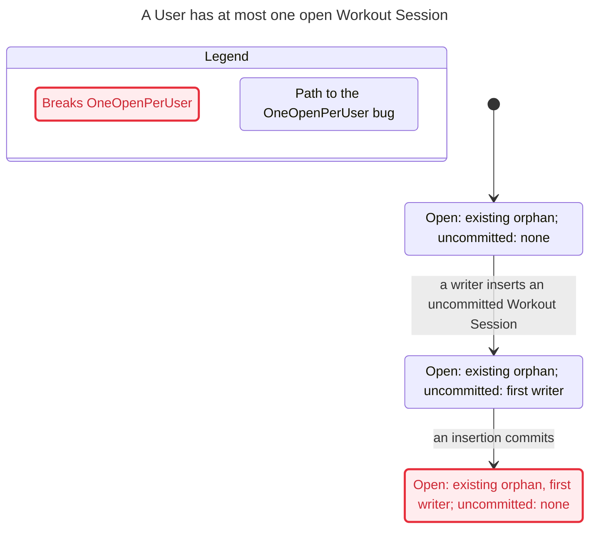

# Validation, 2026-11-01

## Maintenance against current main

**Outcome: updated verification; model and promise in sync; no current-code violation found within the stated bounds.**

Initial audited source: `2ecea816868d542c1fa9b8cabb6004e3db2b2bd7`. `git ls-remote origin refs/heads/main` confirmed this exact checkout HEAD was remote main on 2026-11-01. Shipping fetched a newer main, audited below; the final sync is `6c7bd6cb90f6a0d0cddeae770e1e200eef64c4d3`. The local `main` ref was older and was not used as the source. No checkout switch, product edit, migration edit, property change, or bound reduction was made.

Tools: Node 26.13.0, TLC 1.7.4 (TLC2 2.19, pinned SHA-256 unchanged), OpenJDK Temurin 27, PostgreSQL 17.11. The sandbox initially denied TLC's socket creation (`java.net.SocketException: Operation not permitted`); reruns with local socket permission completed. No project database or environment file was used.

### Baseline and source audit

The unchanged runner exited 1 before TLC or SQL: `20261031130000_personal_records.sql touches workout_sessions after the covered migration. Review its effect and update this guard.` This was the intended fail-closed guard detecting an unreviewed migration, not a counterexample or a stale passing proof.

Reviewed all covered-source changes from previous sync `b03f80f8ead38a2ccc6aef1f33473134dfee4e0c` through the checked main, including the messages of these commits:

| Commit | Change and correspondence decision |
| --- | --- |
| `e7fe5ae234c2303357d56c112c4a130151d6383f` — Weekly goals | Finish now calls `recordWeeklyGoal` after claiming/rotating the session. It writes only `weekly_goal_changes`, using the same transaction. Plan edits and account deletion add log writes/deletion and table locks. The generated schema adds the log and restores an unrelated Arnold RLS condition. No change to modeled ownership, rows, index, or commit boundary. |
| `885e55ab2b400e7b2eb6e25f4dfcb1c1ac911e18` — initial verification | Introduced this verification, with the earlier product source as its recorded sync. Read the skill, runner, replay, model, view, mutations, and original validation. No product change. |
| `2ecea816868d542c1fa9b8cabb6004e3db2b2bd7` — Personal records | Finish share-locks Profile and awards Personal records after the guarded `finished_at` update, before transaction completion. Any award/goal failure rolls the finish back; the unique key is not released to another writer until commit. `logSet` adds session locking but writes only sets. Summary queries add read-only record data. The new migration creates a child table with a session FK and policy reads, leaving the parent index and open-state fields unchanged. No model transition or promise change needed. |

Re-read unchanged start/resume/preflight/insert code, delete, `asUser`/`withService`, the unique index and NULL-Workout FK, ADR 0013, and the glossary promise. Searched production session writers and inspected adjacent changes in `personal-records.ts`, `weekly-goals.ts`, `plans.ts`, `profile.ts`, `delete-user-data.ts`, `plan-update.ts`, API/MCP facades, generated relations, and both new migrations. The only session insertion remains `insertOrResume`; finish sets `finished_at`, deletion removes rows, Plan replacement can orphan rows, and Plan Update only stamps `plan_changes_applied_at`. No new insertion, reopening, or ownership-change path was found. Account deletion is safely overapproximated by per-row `Delete` actions: intermediate subsets only remove rows.

The runner now permits the reviewed Personal records migration only at complete-file SHA-256 `bd431d7748c13666b728072e463a35b5c063329902a7a58a58440c736eb39c69`. This is an exact-content review record, not a filename bypass. An edit or another session-related migration still blocks. Added `scripts/verify.test.mjs` to exercise successful preparation and rejection of an index drop appended to the reviewed file or introduced in a later migration. The touched scripts were formatted with the repository's Biome/Ultracite presets in an isolated directory because repository lint excludes `.agents/skills`.

### Results

| Check | Result |
| --- | --- |
| One User, three insertion transactions, optional existing orphan | PASS: 2,360 distinct states, 9,401 generated; queue exhausted |
| Two Users, three insertion transactions, optional existing orphan | PASS: 2,770 distinct states, 12,045 generated; queue exhausted |
| Actual extracted per-User index in isolated Postgres | PASS: competing insert rejected; orphan retains key; rollback/finish release key; independent User allowed |
| Scratch migration with `UNIQUE` removed | Expected `OneOpenPerUser` failure in both TLC configs; SQL commits two open rows, including the orphan path |
| Scratch migration keyed by `workout_id` | Expected `OneOpenPerUser` failure in both TLC configs; SQL commits two open rows, including the orphan path |
| Unmodified source after both scratch mutations | PASS in TLC and SQL |
| Migration-guard regressions | PASS: 3/3; reviewed content accepted, edited content and new index-drop migration rejected |
| Real-Postgres inherited libpq isolation regressions | PASS: 2/2 (host address and service file); replay setup unchanged |
| `/statechart` interpretation | Every completed TLC configuration interpreted with generated model/config/view; normal configs hold `OneOpenPerUser` and model `NoDeadlock`; all four mutant configs give the identical two-step shortest violation below |
| Syntax and isolated repository-preset Biome checks | PASS for both touched JavaScript files |

The model, `OneOpenPerUser`, bounds, and transaction assumptions are unchanged. Failures in the original guard were verification drift; the two mutated index failures are deliberately injected faults, not product findings. The temporary sandbox tool failure was environmental and resolved with socket permission.

All four mutant statecharts show path 0 → 1 → 2: an existing orphan is open; a writer inserts an uncommitted session; that insertion commits, leaving two open sessions for one User. SQL reproduced those steps with both scratch indexes and rejected them with the current index. The chart and exact sequence in the initial validation below still apply. Passing state graphs exceed the 500-state chart budget, so their complete checks yield reports without charts. Mutant reports explore 3,729 / 3,810 states (nonunique, same/two Users) and 3,573 / 3,810 (per-Workout); their charts show only the three states and two arrows on the shortest bug path, omitting all other schedules. This visualization budget is not a proof depth limit.

### Evidence and reproduction

Local temporary artifacts from this run (not permanent repository fixtures):

- Initial post-review pass: `/var/folders/44/gp14q5mn7zv0w9yvnpbxsymc0000gn/T/fitme-session-proof-UVwr6r`.
- Mutation logs and scratch migrations: `/var/folders/44/gp14q5mn7zv0w9yvnpbxsymc0000gn/T/fitme-session-mutations-Z7aTDR`.
- Nonunique / per-Workout exact inputs, TLC logs and SQL replay: sibling proof directories `fitme-session-proof-ePxXwW` / `fitme-session-proof-Ep49BB`.
- Post-mutation normal pass: sibling directory `fitme-session-proof-eF9wdW`.
- Statechart reports and four identical mutant charts: `/private/tmp/fitme-exclusivity-maintenance-20261101/` (baseline, post-mutation, and mutant subdirectories).

After updating this skill and formatting the runner, followed the documented workflow again: direct verification passed in sibling proof directory `fitme-session-proof-ZpwXhI`; both mutations were detected again in `fitme-session-mutations-Wmz1CF` (proof directories `fitme-session-proof-IxHN2T` and `fitme-session-proof-AJVmbN`); the restored-source pass is `fitme-session-proof-U2Iu4m`. The statechart directory's `final-*` subdirectories interpret all eight configurations from that final workflow, with the same state counts and shortest paths. Guard regressions, syntax checks, isolated lint, and `git diff --check` passed. The sync commit was advanced only after these checks completed.

Run the commands in `SKILL.md`; after `verify.mjs` prints a fresh proof directory, interpret each config with the installed statechart skill, for example (replace `PROOF` and use a fresh `--out` for every config):

```sh
TLA2TOOLS=/private/tmp/fitme-tla2tools-1.7.4.jar \
  /Users/kirillprovorov/.agents/skills/statechart/scripts/statechart \
  PROOF/WorkoutSessions.tla --config PROOF/same-user.cfg \
  --view PROOF/view.mjs --out /private/tmp/fitme-exclusivity-fresh-same-user
```

This path records the installed skill used for this run; discover its current installation as `SKILL.md` directs. The TLC jar must have the pinned checksum. Repeat for `two-users.cfg` and for both mutant proof directories.

### Remaining limits

The check remains a finite database-design safety check: three insertion transactions, at most one initial orphan, one/two Users, insertion commit/rollback, committed finish/deletion, and orphaning. It does not cover the new Personal record algorithm, Weekly goal semantics, `logSet`/finish edit ordering, Profile/table/FK lock deadlocks, full migration application, deployed schema, ownership reassignment, reopening finished sessions, or arbitrary-size histories. Model `NoDeadlock` is not a proof that real database transactions cannot deadlock. Existing lifecycle/Personal record integration tests were inspected as complementary evidence but not executed; no service integration or full Supabase replay is claimed.

### Shipping rebase audit

Before opening the PR, fetched main and rebased onto `6c7bd6cb90f6a0d0cddeae770e1e200eef64c4d3` (`feat(services): initialize retained historical personal records`, PR #437). Read its message, changed AGENTS.md guidance, initialization documentation, and all changes to covered source. Finish now calls `lockPersonalRecordHistory`, a transaction-local advisory lock after the Profile lock and before the Plan/session locks. `initializePersonalRecords` reads only finished sessions, awards records chronologically, and writes its completion marker in the same `asUser` transaction. Account deletion adds that marker table to its locks and deletion. The generated schema and migration `20261031140000_personal_record_initializations.sql` add only completion storage, policies, grants, and the retired-id trigger; they do not change session rows or the exclusivity index.

These changes constrain scheduling but preserve the modeled commit boundary and open-state transitions. No model, property, bounds, runner exception, or product fix was needed. Historical record correctness and advisory-lock ordering remain outside this safety check. Coverage and the sync commit now include this source.

Rebased validation passed: the mutation command caught both broken indexes in TLC and SQL, then passed unmodified source with the same 2,360 / 2,770 distinct-state counts. Guard regressions passed 3/3. All six configurations were interpreted with `/statechart`, preserving the same shortest mutation paths and normal passes. Evidence is in sibling mutation directory `fitme-session-mutations-L8Lo3A` and proof directories `fitme-session-proof-Lesyog` (nonunique), `fitme-session-proof-zxxX4X` (per-Workout), and `fitme-session-proof-96Ubwk` (normal); statechart reports use `ship-*` under `/private/tmp/fitme-exclusivity-maintenance-20261101/`. `pnpm turbo run test typecheck --filter='...[origin/main]'` selected no workspace tasks for this verification-only diff; it is not an application-test pass. `git diff --check` passed.

## Initial validation, 2026-10-31

Source commit: `b03f80f8ead38a2ccc6aef1f33473134dfee4e0c`.
Tools used: TLC 1.7.4 (TLC2 2.19), OpenJDK Temurin 27, PostgreSQL 17.11, Node 26.13.0.

The property is **at most one committed open Workout Session per User**, including sessions with no remaining Workout. No violation was found in the current design within the model's stated bounds. Product code and migrations were unchanged.

| Check | Result |
| --- | --- |
| One User, three insertion transactions, optional existing orphan | PASS: 2,360 distinct states, 9,401 generated states |
| Two Users, three insertion transactions, optional existing orphan | PASS: 2,770 distinct states, 12,045 generated states |
| Actual per-User index declaration installed in temporary Postgres | PASS: second open session rejected, orphan still occupies key, rollback and finish release key, another User may start |
| Scratch real migration with `UNIQUE` removed | FAIL as expected in both TLC configurations and SQL |
| Scratch real migration with key changed to `workout_id` | FAIL as expected in both TLC configurations and SQL |
| Unmodified source rerun after both scratch mutations | PASS |
| `/statechart` interpretation of all six final configurations | Matches TLC; both mutated indexes have the same two-step shortest failure |
| JavaScript syntax checks and isolated Biome check using the repository preset | PASS |
| Inherited libpq host-address and service-file isolation regressions | Both failed before environment sanitization and passed after stripping `PG*` from every Postgres subprocess |

Each model has three insertions and at most one preexisting session. It includes uncommitted key reservations, insertion commit/rollback, committed finish/deletion, and orphaning. Finish/deletion are abstracted to the commit that releases the key. This is not an unbounded proof, a full migration replay, a deployed-database audit, or a proof of authentication, API responses, template copying, or Plan rotation. SQL replay installs the extracted real index on a minimal table rather than running the full application.

## Shortest counterexample for both broken variants

The invariant `OneOpenPerUser` means one User cannot have two open Workout Sessions. In the scratch variants it breaks on this path:

0. The User already has an open Workout Session whose Workout was deleted.
1. A writer inserts another Workout Session, which is still uncommitted.
2. That insertion commits. The same User now has two open Workout Sessions.

The real SQL replay repeats this exact orphan-then-insert path. Both broken index variants allow two committed open rows; the current per-User index rejects the insertion. An additional replay starts with two empty preflight reads and then commits two different Workouts; only the broken variants permit both.

The following is the `/statechart` output for either broken variant's same-User case (the two-User case has the same shortest path):



The chart draws only the shortest bug path because the full state graph exceeds `/statechart`'s 500-state chart budget. The passing configurations also exceed that chart budget and produce reports without charts. Their full finite state spaces were still checked. No state constraints or search depth cutoffs were used.

## Reproduce

```sh
node .agents/skills/verify-workout-session-exclusivity/scripts/verify.mjs
node .agents/skills/verify-workout-session-exclusivity/scripts/mutation-check.mjs
node --test .agents/skills/verify-workout-session-exclusivity/scripts/replay.test.mjs
```

Follow `SKILL.md` to read fresh outputs with `/statechart`, review source/model correspondence, and interpret failures. For later drift, use `/maintain-formal-verification-skill`.
