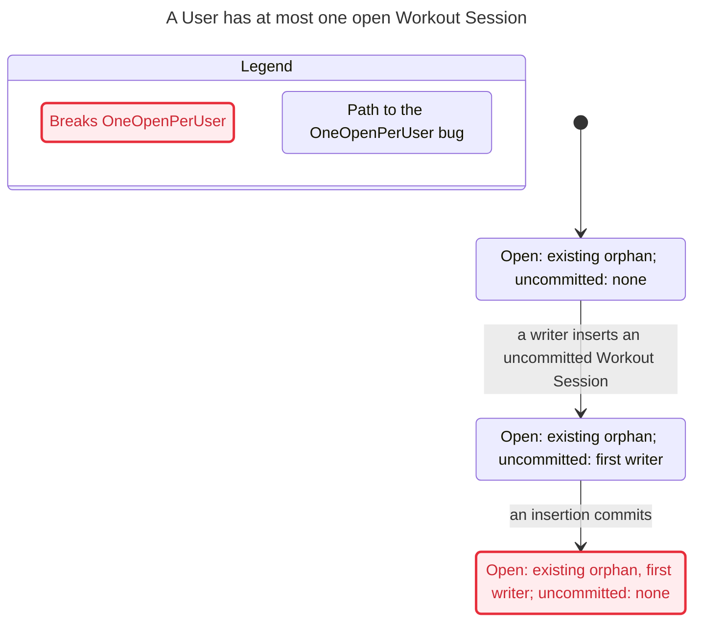

# Validation, 2026-11-28

## Maintenance against current main

**Outcome: updated. The migration guard now pins the Previous sets index migration as reviewed, and the coverage record names the Previous sets reads inside the start and finish transactions; model, property and bounds unchanged; no current-code exclusivity violation found within the stated bounds.**

Audited source: `f222bfb9c8e6a7118969e6108ed5a39b492598f3`, equal to `origin/main` after `git fetch` on 2026-11-28, and the commit the checks ran on. Previous sync: `68df76461acd7f5856b5db92f6b5736790456542` (37 commits). No product code, property, model or bound was changed.

Tools: Node 26.13.1, OpenJDK 27, TLC 1.7.4 (cached jar, pinned SHA-256 unchanged), PostgreSQL 17.11 (Homebrew).

### Baseline

The unchanged runner failed closed before any edit: `20261127120000_workout_sessions_user_started_at_index.sql touches workout_sessions after the covered migration`. That is the guard doing its job, not a finding about the property: no model or SQL check ran.

### Correspondence audit

`git diff -G'workout_sessions|workoutSessions|finished_at|finishedAt'` over the range lists, outside `apps/mobile` and this skill, `AGENTS.md`, `apps/api/integration/previous-sets.test.ts`, `packages/db/src/schema.ts`, `packages/services/src/workout-sessions.ts`, the new migration and its pgTAP test. In `packages/services` only `workout-sessions.ts` changed, and only by additions: `PreviousSet`, `MAX_PREVIOUS_SET_NUMBER`, `getPreviousSets` and `withPreviousSets`. Every Drizzle write to `workout_sessions` outside tests is still one of: the insert in `insertOrResume`, `claimNow`, `claimForgotten`, `deleteWorkoutSession`, `discardForgottenWorkoutSession`, `deleteUserData` and the Plan Update's `plan_changes_applied_at` stamp; none of them has a hunk in the range. `findOpenSession`, `insertOrResume`, `startWorkoutSession`, `finishSession`, `closeForgottenWorkoutSession`, the unique index and its migration are unchanged.

| Commit | Change and correspondence decision |
| --- | --- |
| `557311b8`: the previous resync, PR #780 | This skill only. No effect. |
| `ecb6c610`: FIT-850, PR #786 | `getPreviousSets` is one read-only `select` over `workout_sessions`, `workout_session_exercises` and `workout_session_exercise_sets`, filtered on the User. In `apps/api/src/services.ts`, `startWorkoutSession` (when `started`), `finishWorkoutSession` (when `finished`) and `getWorkoutSession` now call `withPreviousSets` in the same `inUnits` / `weighed` transaction, after the service call and before the commit. The commit boundary is unchanged. A failing read rolls the whole transaction back, which is `Rollback` for a start (the key is released, no row is published) and a stutter for a finish (the session stays open). No effect; named in the facade row and the read-only row. |
| `012cffaf`: FIT-851, PR #792 | `20261127120000_workout_sessions_user_started_at_index.sql`: `CREATE INDEX IF NOT EXISTS workout_sessions_user_id_started_at_idx ON public.workout_sessions(user_id, started_at, id)`. It is nonunique and has no predicate, so it reserves no key, writes no row and leaves `workout_sessions_one_open_per_user_idx` alone. Drizzle's schema lists it; the services comment names it. No effect. The guard now pins its complete SHA-256 (`cc9cb64b…`). |
| `79e70bd1`, `0af9b5c8`, `f65a9a1e`: FIT-827, FIT-830, FIT-832 (PRs #769, #787, #799) | MCP notes tools over `listExerciseNotes`, `setExerciseNote` and `setWorkoutSessionSetNote`, and `noted`, which reads Exercise notes (`listExerciseNotes`) after the service call inside the same `asUser` of `startWorkoutSession` and `finishWorkoutSession`, only when the result is `started` or `finished`, and of the reads. Like the API's Previous sets, this adds an abort point before the commit and writes nothing. No effect; named in the facade row. |
| `625e7486`, `618406d6`, `febdc09f`: FIT-828, FIT-831, FIT-833 (PRs #781, #796, #806) | Arnold's `set_exercise_note`, `set_workout_session_set_note` (one `asUser` over `setWorkoutSessionSetNote`, already covered) and `list_exercise_notes`, and Exercise notes in `get_open_workout_session`, `get_active_plan` and `get_workouts_history` (reads). No session row write. No effect. |
| `46ce7c34`: FIT-869, PR #775 | The identity-merge script reads `private.retired_user_ids` through `withService`, read-only. No effect. |
| `7d09359d`: FIT-867, PR #782 | The Clerk webhook deletes the PostHog person after `deleteUserData` commits. `deleteUserData` is unchanged. No effect. |
| `6f5a1cb2`: FIT-876, PR #807 | Observability tests. No effect. |
| `5b892833`, `ac70bbb7`: site (PRs #773, #783) | No database access. No effect. |
| `743f395c`, `599e4968`: i18n (PRs #790, #810) | Catalogs. No effect. |
| `144894c2`, `78129faf`, `c9a59894`, `44f6b97f`, `8b314f07`, `04ce8ad2`, `6ba6f7b3`, `cf83ed1b`, `764d3fa6`, `ed89f23f`, `0c75deac`, `67623143`, `2834b5d0`, `a87053a4`, `7ec355f7`, `dbe8b70a`, `23505b52`, `03332351`, `a1619b1c`, `77d9504f`, `f222bfb9`: mobile (PRs #771, #779, #784, #785, #788, #789, #791, #793–#795, #797, #798, #800–#805, #808, #809, #811) | App code, the fake Public API and tests; the app reaches sessions only through the Public API. No effect. |

### What changed in the verification

- `scripts/verify.mjs`: `20261127120000_workout_sessions_user_started_at_index.sql` joins the reviewed migrations with its complete SHA-256, and the comment says why a nonunique index has no modeled effect. Why: the code changed shape (a new migration names the table), not the promise.
- `scripts/verify.test.mjs`: a sixth guard scenario, `edited-previous-sets-index`, appends `DROP INDEX public.workout_sessions_one_open_per_user_idx;` to that migration and requires the guard to reject it.
- `SKILL.md`: the sync commit; the facade row says the start and finish facades read Previous sets (API) and Exercise notes (MCP) before commit, and what a failure there means in the model; `getPreviousSets` / `withPreviousSets` join the read-only row; the reviewed-migrations table gains the new row and a sentence on it; the scenario count; Previous sets correctness joins the excluded list.

### Results

| Check | Outcome and result |
| --- | --- |
| One User, three insertion transactions, optional initial orphan | Updated: PASS, 2,360 distinct / 9,401 generated, queue exhausted |
| Two Users, three insertion transactions, optional initial orphan | Updated: PASS, 2,770 distinct / 12,045 generated, queue exhausted |
| Extracted actual index, isolated PostgreSQL replay | Updated: PASS |
| Migration guard regressions | 6 of 6, including the new edited-migration scenario |
| Scratch migration with `UNIQUE` removed | Expected failure, caught by TLC and Postgres |
| Scratch migration indexed by `workout_id` | Expected failure, caught by TLC and Postgres |
| Unmodified source after both mutations | PASS in both TLC configs and SQL |
| `/statechart` | Run on this run's generated model, each config and `view.mjs` (`TLA2TOOLS` pointed at the runner's cached pinned jar): `OneOpenPerUser` and `NoDeadlock` hold in both. The 2,360 and 2,770 states are over its 500-state chart budget, so it drew no chart. |

The state counts equal the previous validation's, as an unchanged model must give. The new guard scenario shows that pinning the migration did not weaken the guard: an edit that drops the unique index from the pinned file is rejected. The replay-isolation regressions were not rerun, because the SQL runner didn't change.

### Remaining limits

As before. The new facade reads are audited by reading the code only: the runner never reads the TypeScript, and `apps/api/integration/previous-sets.test.ts` is not run by this checker. The pinned migration is checked by its hash, not by what it means: the review above is what says a nonunique index has no effect.

## Previous validation, 2026-11-27

## Maintenance against current main

**Outcome: updated. The coverage record now names the job's real calls to the Forgotten Workout Session services, set notes, Arnold's set removal and the notes migration; model, property, bounds, runner and migration guard unchanged; no current-code exclusivity violation found within the stated bounds.**

Audited source: `68df76461acd7f5856b5db92f6b5736790456542`, equal to `origin/main` after `git fetch` on 2026-11-27, and the commit the checks ran on. Previous sync: `714819a101def141d111d83d848a8d3690c8e29e` (35 commits). No product code, migration, property, model, bound or script was changed.

Tools: Node 26.13.1, OpenJDK 27, TLC 1.7.4 (cached jar, pinned SHA-256 unchanged), PostgreSQL 17.11 (Homebrew).

### Baseline

The unchanged runner passed before any edit: same-user 2,360 distinct / 9,401 generated, two-users 2,770 / 12,045, SQL replay PASS. One migration was added, `20261126120000_notes.sql`; it never names `workout_sessions` or `workout_sessions_one_open_per_user_idx`, so the guard let it through (reviewed below). That pass only said the old description still held; the audit below is what says it still describes the code.

### Correspondence audit

`git diff -G'workout_sessions|workoutSessions|finished_at|finishedAt'` over the range lists, outside this skill, `AGENTS.md`, `packages/services/src/workout-sessions.ts`, the removed `apps/api/src/rewrite-exercise-slugs.ts`, the notes pgTAP test, and integration and mobile tests and hooks. Every Drizzle write to `workout_sessions` outside tests is still one of: the insert in `insertOrResume`, `claimNow`, `claimForgotten`, `deleteWorkoutSession`, `discardForgottenWorkoutSession`, `deleteUserData` and the Plan Update's `plan_changes_applied_at` stamp; none of them has a hunk in the range. `findOpenSession`, `insertOrResume`, `startWorkoutSession`, `finishSession`, `closeForgottenWorkoutSession`, the unique index and its migration are unchanged.

| Commit | Change and correspondence decision |
| --- | --- |
| `50ae4ef2` — the previous resync, PR #742 | This skill only. No effect. |
| `47e9fc1e`, `de47804f`, `bb76584c`, `590e921e`, `d0deeff8`, `ea0e999b` — docs (PRs #741, #758, #757, #754, #753, #768) | `GLOSSARY.md` adds Note and Previous set and says a deleted Plan is gone; ADRs 0025 and 0026; research notes. The Workout Session and Forgotten Workout Session definitions are unchanged. No effect. |
| `57b14aca` — FIT-821, PR #743 | `@fitme/core`'s `cleanNote` and `MAX_NOTE_LENGTH`. Pure code. No effect. |
| `dfdb4f58` — PR #744 | `20261126120000_notes.sql`: a nullable `note` column and NOT VALID CHECK on `workout_session_exercise_sets`, and the new `exercise_notes` table with its RLS, grants and retired-id trigger; the generated schema follows. No session row, ownership or index is touched, and the logged-set trigger (`count_workout_session_logged_sets`, `UPDATE OF workout_session_exercise_id, reps_completed` in `20261101100000_workout_session_progress.sql`) doesn't fire on `note`. No effect; recorded among the no-effect migrations. |
| `b6a12950` — FIT-823, PR #756 | `exercise-notes.ts` writes only `exercise_notes`; `deleteUserData` locks it last and deletes its rows. The session delete in `deleteUserData` is unchanged. No effect. |
| `8d1abfb5` — FIT-800, PR #738 | Arnold's `remove_set_from_workout_session` calls `removeSetFromWorkoutSession` in one `asUser`: deletes a set, never a session row. No effect; added to the no-effect row. |
| `bf3a2069` — FIT-817, PR #755 | The job now calls the services: `listForgottenWorkoutSessions` in one `withService` transaction, then each id through `closeForgottenWorkoutSession` in a `withService` transaction of its own, sequentially, under `transaction_timeout` (50 s) and `statement_timeout` (20 s). The grep for the four service names finds no other non-test caller; `run-forgotten-workout-sessions.ts` (by hand, local databases only) runs the same job function, and `create-handler.ts` only wraps it in the cron monitor. That is exactly the boundary the last audit flagged for re-audit: each close is one `Finish` or `Delete` (or a stutter) with its own commit; a timeout aborts it and rolls it back. Overlapping runs add `Finish` / `Delete` callers, which the model already interleaves freely. The `apps/jobs` row now describes this. |
| `96daccd0`, `25cb3d56` — FIT-825, FIT-829 (PRs #776, #777) | `setWorkoutSessionSetNote`: the session tables' ROW EXCLUSIVE locks, a `FOR NO KEY UPDATE` lock on the set's session (open or finished), then an UPDATE of `workout_session_exercise_sets.note` only; every set read now carries `note`. The facade (`setWorkoutSessionSetNote` in `apps/api/src/services.ts`) is one `asUser` transaction. No session row write. No effect; added to the no-effect row, and set notes named among the excluded finished-session edits. |
| `9a714949` — FIT-826, PR #770 | `GET` / `PUT /v1/exercise-notes` over `exercise-notes.ts`. No effect. |
| `4491170f` — FIT-792, PR #762 | Removes `rewrite-exercise-slugs.ts` (which locked but never wrote session rows) and its row in this skill. No effect. |
| `a8dccd7c` — PR #772 | TypeScript 6.0.3 in every manifest; no source change under `packages/services`, `packages/db` or `apps/jobs`. No effect. |
| `7ac3b6a4`, `91622cc0` — FIT-787, FIT-789 (PRs #752, #767) | Library API auth and `@fitme/library-sdk`. No database access. No effect. |
| `63fee68a` — FIT-791, PR #763 | Arnold's build. No effect. |
| `624586eb`, `ad72206c`, `cf420200`, `fa6e63e8`, `cbb40faa`, `2f6e4609`, `0450b8fa`, `f4f432d3`, `b3b66396`, `f11f5da5`, `cf3c12e5`, `952b29d0`, `68df7646` — mobile and tooling (PRs #745–#751, #759–#761, #764, #774, #778) | App code, the fake Public API, scripts and tests. No effect. |
| `597e30b6`, `de6324a6` — PRs #765, #766 | i18n catalogs. No effect. |

### What changed in the verification

- `SKILL.md`: the `apps/jobs` row now describes the job's real transaction boundaries instead of a pending re-audit; the no-effect row adds `setWorkoutSessionSetNote` (service and API facade) and Arnold's `remove_set_from_workout_session`; `20261126120000_notes.sql` joins the no-effect migrations; set notes are named in the finished-session-edit exclusion; the sync commit. Why: the code changed shape (a new caller and a new set write), not the promise.

### Results

| Check | Outcome and result |
| --- | --- |
| One User, three insertion transactions, optional initial orphan | Updated: PASS, 2,360 distinct / 9,401 generated, queue exhausted |
| Two Users, three insertion transactions, optional initial orphan | Updated: PASS, 2,770 distinct / 12,045 generated, queue exhausted |
| Extracted actual index, isolated PostgreSQL replay | Updated: PASS |
| Migration guard regressions | 5 of 5 |
| Scratch migration with `UNIQUE` removed | Expected failure, caught by TLC and Postgres |
| Scratch migration indexed by `workout_id` | Expected failure, caught by TLC and Postgres |
| Unmodified source after both mutations | PASS in both TLC configs and SQL |
| `/statechart` | Run on this run's generated model, each config and `view.mjs` (the installed skill has no `mise` here, so `TLA2TOOLS` pointed at the runner's cached pinned jar): `OneOpenPerUser` and `NoDeadlock` hold in both; 2,360 and 2,770 states are over its 500-state chart budget, so no chart. |

The state counts equal the previous validation's, as an unchanged model must give. The mutations show the checker can still fail on the index; the runner never reads the TypeScript, so the job's transaction boundaries and the set-note write are covered by the manual correspondence above only, not mechanically. The replay-isolation regressions were not rerun: the SQL runner didn't change.

### Remaining limits

As before. The job is now audited by reading it; `apps/jobs`' tests inject fakes and `packages/services`' `workout-session-set-notes.test.ts` and the other integration tests are not run by this checker. The guard only sees migrations that name the table or its index: the notes migration was reviewed by hand because it touches a child table.

## Previous validation, 2026-11-26

## Maintenance against current main

**Outcome: updated. The coverage record now names the Forgotten Workout Session finish and discard (ADR 0024) and the set removal; model, property, bounds, runner and migration guard unchanged; no current-code exclusivity violation found within the stated bounds.**

Audited source: `714819a101def141d111d83d848a8d3690c8e29e`, equal to `origin/main` after `git fetch` on 2026-11-26. Previous sync: `b99cb39e9735e39b5ca13d5c6a4cee8a9ba3ab5a` (29 commits). The checks ran on `e04603ac`; `714819a1` (PR #740, FIT-807) changes only `apps/mobile` and touches no covered file, so the results hold for it. No product code, migration, property, model, bound or script was changed.

Tools: Node 26.13.1, OpenJDK 27, TLC 1.7.4 (cached jar, pinned SHA-256 unchanged), PostgreSQL 17.11 (Homebrew).

### Baseline

The unchanged runner passed before any edit: same-user 2,360 distinct / 9,401 generated, two-users 2,770 / 12,045, SQL replay PASS. No migration was added or edited (newest is still `20261124120000_personal_records_write_policies.sql`), so the guard had nothing to refuse. That pass only said the old description still held; the audit below is what says it still describes the code.

### Correspondence audit

`git diff -G'workout_sessions|workoutSessions|finished_at|finishedAt'` over the range lists, outside this skill, `packages/services/src/workout-sessions.ts`, ADR 0024, `AGENTS.md`, the API set route, the MCP session tools, Arnold's eval fixtures and test, mobile code and tests, and two service integration tests. Every Drizzle write to `workout_sessions` outside tests is one of: the insert in `insertOrResume`, `claimNow`, `claimForgotten`, `deleteWorkoutSession`, `discardForgottenWorkoutSession`, `deleteUserData` and the Plan Update's `plan_changes_applied_at` stamp; no `tx.execute` writes one. `findOpenSession`, `insertOrResume` and `startWorkoutSession` have no hunk, and `packages/db` and `packages/supabase` are untouched.

| Commit | Change and correspondence decision |
| --- | --- |
| `eb70ab1e` — the previous resync, PR #712 | This skill only. No effect. |
| `5205dfc6`, `681ab133`, `be6cd97b`, `98bdc893`, `aa768bae`, `18d4e911`, `093c69d3` — Discard (PRs #713–#719) | `GLOSSARY.md` defines Discard and ADR 0013 now says "finished or discarded": the promise (at most one open session) is unchanged, and Discard is `DELETE /v1/workout-sessions/{id}`, the existing `deleteWorkoutSession` (`Delete`). The rest is i18n catalogs, the mobile fake Public API and screens. No effect. |
| `d26bd904` — PR #704 | Expo patch bumps. No effect. |
| `4f8408aa` — ADR 0023, PR #720 | Docs. No effect. |
| `cc808edb` — FIT-795, PR #724 | Arnold's `get_open_workout_session`: `listWorkoutSessions` then `getWorkoutSession`, read-only. No effect. |
| `60eef307` — ADR 0024, PR #726 | Defines Forgotten Workout Sessions and the job. Docs; the code it describes is below. |
| `aabdb0ea` — FIT-811, PR #727 | `runMonitored` in `@fitme/observability`. No database access. No effect. |
| `0ea6b098` — FIT-812, PR #728 | `apps/jobs`, whose job runs only `select 1` through `withService`. No effect yet; flagged for re-audit. |
| `25321f62`, `6cde5f82`, `edc028f6`, `94313b32`, `e04603ac`, `714819a1` — mobile (PRs #729, #722, #730, #732, #739, #740) | App code, the fake Public API and tests. No effect. |
| `0325ee85` — FIT-793, PR #723 | `removeSetFromWorkoutSession`: deletes one `workout_session_exercise_sets` row after `lockSessionOfExercise`; the session row is locked, never written. No effect. |
| `248ad0c4`, `d34bf348` — FIT-794, FIT-803 (PRs #725, #736) | Plan Update set removals: deletes Plan sets (`workout_exercise_sets`); the session write is still only the stamp. Facade signature change only. No effect. |
| `4716eaf2`, `a2cc7626` — PRs #721, #735 | i18n catalogs. No effect. |
| `82ea69e0` — FIT-798, PR #731 | `DELETE /v1/workout-session-sets/{id}` and its facade method, one `asUser` transaction. No effect. |
| `2e536be0` — FIT-810, PR #734 | Finishing split into `finishSession` with a `claim`: `claimNow` is the old UPDATE, now also filtered on the session row's own `user_id`; `claimForgotten` row-locks the open row `FOR NO KEY UPDATE`, then sets `finished_at` to the last set's `logged_at` only where `openSessionOf` holds and that time is at least 3 hours old. Both are `Finish` (an open row gets a non-NULL `finished_at`, releasing the key at commit); a NULL subquery makes the WHERE NULL, so nothing is written (stutter), never a reopen. `rotateWorkout` filters on the User. Personal records and Weekly goal comments only. |
| `cb708509` — FIT-814, PR #737 | `listForgottenWorkoutSessions` (an unlocked read of open rows) and `closeForgottenWorkoutSession`, which runs at most one of `finishForgottenWorkoutSession` (`Finish`) or `discardForgottenWorkoutSession` (`Delete` of an open, unlogged row under `FOR UPDATE`) in the caller's one `withService` transaction. No insert, reopen or reassignment. |
| `d2f77ea4` — FIT-799, PR #733 | MCP's `remove_set_from_workout_session` over the same service. No effect. |

### What changed in the verification

- `SKILL.md`: the Finish/Delete row names `finishSession`, `claimNow`, `claimForgotten`, `finishForgottenWorkoutSession`, `closeForgottenWorkoutSession` and `discardForgottenWorkoutSession`, and why neither claim reopens a session; a no-effect row for the listing, the set removal (service, both facades, Plan Update) and Arnold's read; an `apps/jobs` row to re-audit once the job calls the services; the ADR 0013 / glossary row cites the "finished or discarded" wording; the Forgotten cutoff, backdating and ADR 0024's Personal-record-order reliance added to the exclusions; the sync commit. Why: the code changed shape (new finish and delete paths), not the promise.

### Results

| Check | Outcome and result |
| --- | --- |
| One User, three insertion transactions, optional initial orphan | Updated: PASS, 2,360 distinct / 9,401 generated, queue exhausted |
| Two Users, three insertion transactions, optional initial orphan | Updated: PASS, 2,770 distinct / 12,045 generated, queue exhausted |
| Extracted actual index, isolated PostgreSQL replay | Updated: PASS |
| Migration guard regressions | 5 of 5 |
| Scratch migration with `UNIQUE` removed | Expected failure, caught by TLC and Postgres |
| Scratch migration indexed by `workout_id` | Expected failure, caught by TLC and Postgres |
| Unmodified source after both mutations | PASS in both TLC configs and SQL |
| `/statechart` | Not run: both state spaces are over its 500-state chart budget, so it would give no chart; the complete TLC passes stand. |

The state counts equal the previous validation's, as an unchanged model must give. The mutations show the checker can still fail on the index; the runner never reads the TypeScript, so the new service paths are covered by the manual correspondence above only, not mechanically. The replay-isolation regressions were not rerun: the SQL runner didn't change.

### Remaining limits

As before, plus: the job doesn't call the Forgotten Workout Session services yet, so its transaction boundaries are unaudited; `forgotten-workout-sessions.test.ts` (which seeds sessions by direct insert) and the other integration tests are not run by this checker.

## Previous validation, 2026-11-25

## Maintenance against current main

**Outcome: updated. The migration guard pins one newly reviewed migration and its regressions cover it; model, property and bounds unchanged; no current-code exclusivity violation found within the stated bounds.**

Audited source: `b99cb39e9735e39b5ca13d5c6a4cee8a9ba3ab5a`, equal to `origin/main` after `git fetch` on 2026-11-25. Previous sync: `90e382f78e5ff1339b04c6e1999a4ad3682bf086` (7 commits). No product code, migration, property, model or bound was changed.

Tools: Node 26.13.1, OpenJDK 27, TLC 1.7.4 (cached jar, pinned SHA-256 unchanged), PostgreSQL 17.11 (Homebrew).

### Baseline

The unchanged runner refused to run (exit 1, before TLC or Postgres): `20261124120000_personal_records_write_policies.sql touches workout_sessions after the covered migration. Review its effect and update this guard.` The `reviewed` guard regression failed for the same reason. That is the guard failing closed on an unreviewed migration: drift in the verification, not a bug in the code, and no stale pass was reported.

### Correspondence audit

| Commit | Change and correspondence decision |
| --- | --- |
| `8d74e65a` — the previous resync, PR #705 | This skill's own `SKILL.md` and `VALIDATION.md`. No effect. |
| `16d8f540` — PR #706 | The order of two lines in `scripts/app-store-screenshots.test.mjs`. No effect. |
| `c3f8f7b8` — FIT-779, PR #707 | `@clerk/mcp-tools` 1.0: `apps/mcp/src/auth.ts` (the OAuth metadata document) and `create-app.ts` (the transport class passed in), their test and README. The facade (`apps/mcp/src/services.ts`) and the tools are untouched, so start/finish/delete keep their transactions. No effect. |
| `2059f67a` — FIT-778, PR #708 | Migration `20261124120000_personal_records_write_policies.sql`, the regenerated policies in `packages/db/src/schema.ts`, and two test files. It drops `personal_records`' `FOR ALL` policy and creates one per write command with the same clauses, reading `workout_sessions` only inside two `EXISTS (SELECT …)`. It writes no session, adds no trigger and doesn't touch the index; a refused award rolls back its whole finish. RLS is excluded already. The model is unaffected; the guard is updated (below). |
| `f531c204` — FIT-780, PR #709 | eve and `@assistant-ui/eve` bump, eve's stream reader patch, a comment in `apps/arnold/agent/sandbox.ts`. Arnold starts, finishes and deletes no session. No effect. |
| `15429e14` — FIT-762, PR #710 | `/v1/muscle-groups`' list: `apps/api/src/routes/exercises.ts`, `muscle-groups.ts`, `schemas.ts`, generated documents and a test. No database access. No effect. |
| `b99cb39e` — FIT-763, PR #711 | `.github/oasdiff/allowed-breaking-changes.txt`. No effect. |

`packages/services/src`, both facades (`apps/api/src/services.ts`, `apps/mcp/src/services.ts`), `packages/db/src/index.ts` and `client.ts`, `apps/webhooks`, ADR 0013 and `GLOSSARY.md` are untouched, and `pnpm-lock.yaml` moves no `pg` or `drizzle-orm` version. The only changed lines mentioning `workout_sessions` or `finished_at` outside this skill are the migration's and `schema.ts`'s policies.

### What changed in the verification

- `scripts/verify.mjs`: the migration added to `reviewedMigrations` by its complete SHA-256 (`d4387eac788bdb8268473caebfa286af3595b1960e525ae7264dc2e1c40d67aa`). Why: the code changed shape (a policy split), not the promise.
- `scripts/verify.test.mjs`: an `edited-policies` scenario, so the new pin must reject an edit of that file; the file per scenario is now a map.
- `SKILL.md`: the migration's row in the correspondence and SHA-256 tables, the sync commit.

### Results

| Check | Outcome and result |
| --- | --- |
| One User, three insertion transactions, optional initial orphan | Updated: PASS, 2,360 distinct / 9,401 generated, queue exhausted |
| Two Users, three insertion transactions, optional initial orphan | Updated: PASS, 2,770 distinct / 12,045 generated, queue exhausted |
| Extracted actual index, isolated PostgreSQL replay | Updated: PASS |
| Migration guard regressions | 5 of 5; an index drop appended to the newly pinned file is rejected |
| Scratch migration with `UNIQUE` removed | Expected failure, caught by TLC and Postgres |
| Scratch migration indexed by `workout_id` | Expected failure, caught by TLC and Postgres |
| Unmodified source after both mutations | PASS in both TLC configs and SQL |
| `/statechart` | Not run: both state spaces are over its 500-state chart budget (2,360 / 2,770), so it would give no chart; the complete TLC passes stand. |

The state counts are those of the previous validation, as an unchanged model must give. The replay-isolation regressions were not rerun: the SQL runner's process and connection setup didn't change.

### Remaining limits

Unchanged from the previous validation. The new `personal-records.test.ts` integration tests and the pgTAP policy count are not run by this checker.

## Previous validation, 2026-11-23

## Maintenance against current main

**Outcome: in sync. Model, property, bounds, runner and coverage record unchanged; no current-code exclusivity violation found within the stated bounds.**

Audited source: `90e382f78e5ff1339b04c6e1999a4ad3682bf086`, equal to `origin/main` after `git fetch` on 2026-11-23. Previous sync: `3bb4fa4ac5966f8cfeeeec0d43c4ca13d56f0a0e` (4 commits). No product code, migration, property, model, bound or script was changed.

Tools: Node 26.13.1, OpenJDK 27, TLC 1.7.4 (cached jar, pinned SHA-256 unchanged), PostgreSQL 17.11 (Homebrew).

### Correspondence audit

`git diff --name-only` since the previous sync touches no covered file or directory (`packages/supabase`, `packages/services`, `packages/db`, `apps/api`, `apps/mcp`, `apps/arnold`, `apps/webhooks`, ADR 0013, `GLOSSARY.md`) and adds no migration (newest is still `20261109130000_plan_details_optional.sql`). The only `packages/` change is `packages/i18n` (one catalog key dropped), which never reaches Postgres:

| Commit | Change and correspondence decision |
| --- | --- |
| `74317587` — the previous resync, PR #700 | This skill's own `SKILL.md` and `VALIDATION.md`. No effect. |
| `64eaf148` — home workouts in the planner, PR #702 | `apps/mobile/app/planner/index.tsx` makes the `home` Place choosable (drops the "Soon" badge and `soonPlaces`), its test, `planner.place.soon` dropped from every catalog, a marketing note. The planner only hands Arnold a request; a Plan it yields is saved through `POST /v1/plans`, unchanged. No Workout Session is started, finished or deleted. No effect. |
| `6010017b` — FIT-776, PR #701 | `apps/mobile/store.config.json` listing text in 15 locales. No effect. |
| `90e382f7` — FIT-777, PR #703 | `scripts/app-store-screenshots.mjs` emoji check and its tests, `README.md`, `AGENTS.md`'s command line, the screenshots README. No effect. |

No changed non-Markdown line mentions `workout_sessions`, `workoutSessions`, `finished_at`, `insertOrResume`, `startWorkoutSession` or a migration. Every function the correspondence table names lives in an untouched file.

### Results

| Check | Outcome and result |
| --- | --- |
| One User, three insertion transactions, optional initial orphan | In sync: PASS, 2,360 distinct / 9,401 generated, queue exhausted |
| Two Users, three insertion transactions, optional initial orphan | In sync: PASS, 2,770 distinct / 12,045 generated, queue exhausted |
| Extracted actual index, isolated PostgreSQL replay | In sync: PASS |
| Scratch migration with `UNIQUE` removed | Expected failure, caught by TLC and Postgres |
| Scratch migration indexed by `workout_id` | Expected failure, caught by TLC and Postgres |
| Unmodified source after both mutations | PASS in both TLC configs and SQL |
| `/statechart` | Not run: both state spaces are over its 500-state chart budget (2,360 / 2,770), so it would give no chart; the complete TLC passes stand. |

Nothing in the model changed, so the baseline run and the final run are the same. The two index mutations remain the "can still fail" evidence. Migration-guard and replay-isolation regressions were not rerun: neither the guard nor the runner changed.

### Remaining limits

Unchanged from the previous validation.

## Previous validation, 2026-11-22

## Maintenance against current main

**Outcome: in sync. Model, property, bounds, runner and coverage record unchanged; no current-code exclusivity violation found within the stated bounds.**

Audited source: `3bb4fa4ac5966f8cfeeeec0d43c4ca13d56f0a0e`, equal to `origin/main` after `git fetch` on 2026-11-22. Previous sync: `08fc1c717d64ebc7c010f54ee80b1542ecfb89c0` (9 commits). No product code, migration, property, model, bound or script was changed.

Tools: Node 26.13.1, OpenJDK 27, TLC 1.7.4 (cached jar, pinned SHA-256 unchanged), PostgreSQL 17.11 (Homebrew).

### Correspondence audit

`git diff --name-only` since the previous sync touches no covered file or directory (`packages/supabase`, `packages/services`, `packages/db`, `apps/api/src`, `apps/mcp`, ADR 0013, `GLOSSARY.md`) and adds no migration. The only `packages/` change is `packages/i18n` (catalogs and `src/format.ts`), which formats text on the phone and never reaches Postgres:

| Commit | Change and correspondence decision |
| --- | --- |
| `0fcd3ff3` — the previous resync, PR #691 | This skill's own `SKILL.md` and `VALIDATION.md`. No effect. |
| `057ab6d0` — FIT-772, PR #692 | `formatVolume` / `spokenVolume` in `packages/i18n/src/format.ts`, History's row and the Workout Session stats (`apps/mobile/components/workout-sessions/workout-session-stats.tsx`), their tests, and `AGENTS.md`'s `src/format.ts` line. Display only; the app reaches Workout Sessions only through the Public API, unchanged. No effect. |
| `8208e46c`, `0a3fa6da`, `e6b0a2dd`, `5bf79b80` (PRs #693–#695, #697) | `apps/mobile` UI only (the auth form's scroll, the Volume stat's fit, the clip placeholder and header, the model picker sheet) and their tests. No effect. |
| `b9e0f7c0` — FIT-771, PR #696 | My Plans' VoiceOver label, its catalog strings in every `packages/i18n` catalog, and an `AGENTS.md` line. No effect. |
| `b7edb954` — PR #698 | `apps/mobile/lib/plan-changes.ts`, the Plan Update sheet's line formatter, and its tests. It formats the Public API's answer; `plan-update.ts` in `packages/services` is untouched. No effect. |
| `3bb4fa4a` — PR #699 | `marketing/screenshots/` images. No effect. |

The one changed `AGENTS.md` line naming Workout Sessions is `src/format.ts`'s description (`counts.workoutSessions`, `formatVolume`); none mentions a migration or the unique index.

### Results

| Check | Outcome and result |
| --- | --- |
| One User, three insertion transactions, optional initial orphan | In sync: PASS, 2,360 distinct / 9,401 generated, queue exhausted |
| Two Users, three insertion transactions, optional initial orphan | In sync: PASS, 2,770 distinct / 12,045 generated, queue exhausted |
| Extracted actual index, isolated PostgreSQL replay | In sync: PASS |
| Scratch migration with `UNIQUE` removed | Expected failure, caught by TLC and Postgres |
| Scratch migration indexed by `workout_id` | Expected failure, caught by TLC and Postgres |
| Unmodified source after both mutations | PASS in both TLC configs and SQL |
| `/statechart` | Not run: both state spaces are over its 500-state chart budget (2,360 / 2,770), so it would give no chart; the complete TLC passes stand. |

Nothing in the model changed, so the baseline run and the final run are the same. The two index mutations remain the "can still fail" evidence. Migration-guard and replay-isolation regressions were not rerun: neither the guard nor the runner changed.

### Remaining limits

Unchanged from the previous validation.

## Previous validation, 2026-11-21

## Maintenance against current main

**Outcome: in sync. Model, property, bounds, runner and coverage record unchanged; no current-code exclusivity violation found within the stated bounds.**

Audited source: `08fc1c717d64ebc7c010f54ee80b1542ecfb89c0`, equal to `origin/main` after `git fetch` on 2026-11-21. Previous sync: `6e515a7f8fef85040dbe24b28e8f7a2eb46a54a5` (6 commits). No product code, migration, property, model, bound or script was changed.

Tools: Node 26.13.1, OpenJDK 27, TLC 1.7.4 (cached jar, pinned SHA-256 unchanged), PostgreSQL 17.11 (Homebrew).

### Correspondence audit

`git diff --name-only` since the previous sync touches no covered file or directory (`packages/`, `apps/api/src`, `apps/mcp`, ADR 0013, `GLOSSARY.md`) and adds no migration:

| Commit | Change and correspondence decision |
| --- | --- |
| `d50261e6` — the previous resync, PR #685 | This skill's own `SKILL.md` and `VALIDATION.md`. No effect. |
| `2e07537e`, `54b1b1e6`, `0aa50569`, `2a8b3de4` (PRs #686–#689) | `apps/mobile` UI only (Exercise thumbnail placeholder, the emailed-code screen, the Plan builder's header tints, fitted set fields), their tests and E2E flows, and `AGENTS.md`'s / `docs/agents/ui.md`'s mobile docs. The app reaches Workout Sessions only through the Public API, unchanged. No effect. |
| `08fc1c71` — FIT-768, PR #690 | `.claude/hooks/shell-rules.mjs` and its tests, `AGENTS.md`'s Shell section. No effect. |

No changed line in `AGENTS.md` mentions a Workout Session, a migration or the unique index.

### Results

| Check | Outcome and result |
| --- | --- |
| One User, three insertion transactions, optional initial orphan | In sync: PASS, 2,360 distinct / 9,401 generated, queue exhausted |
| Two Users, three insertion transactions, optional initial orphan | In sync: PASS, 2,770 distinct / 12,045 generated, queue exhausted |
| Extracted actual index, isolated PostgreSQL replay | In sync: PASS |
| Scratch migration with `UNIQUE` removed | Expected failure, caught by TLC and Postgres |
| Scratch migration indexed by `workout_id` | Expected failure, caught by TLC and Postgres |
| Unmodified source after both mutations | PASS in both TLC configs and SQL |
| `/statechart` | Not run: both state spaces are over its 500-state chart budget (2,360 / 2,770), so it would give no chart; the complete TLC passes stand. |

Nothing in the model changed, so the baseline run and the final run are the same. The two index mutations remain the "can still fail" evidence. Migration-guard and replay-isolation regressions were not rerun: neither the guard nor the runner changed.

### Remaining limits

Unchanged from the previous validation.

## Previous validation, 2026-11-20

## Maintenance against current main

**Outcome: in sync. Model, property, bounds and runner unchanged; one row added to the coverage record (the one-off Exercise slug rewrite); no current-code exclusivity violation found within the stated bounds.**

Audited source: `6e515a7f8fef85040dbe24b28e8f7a2eb46a54a5`, equal to `origin/main` after `git fetch` on 2026-11-20. Previous sync: `b1eb1a0b61bb096e3e689f024daa0c37fbd660e2` (22 commits). No product code, migration, property, model, bound or script was changed.

Tools: Node 26.13.1, OpenJDK 27, TLC 1.7.4 (cached jar, pinned SHA-256 unchanged), PostgreSQL 17.11 (Homebrew).

### Baseline

The unchanged runner: both TLC configurations PASS (2,360 / 2,770 distinct states, queues exhausted), SQL replay PASS. Since nothing in the model needed changing, this pass and the final one are the same run.

### Correspondence audit

`git diff` of every covered file and directory since the previous sync (`packages/services`, `packages/db`, `packages/supabase/supabase/migrations`, both facades, ADR 0013, `GLOSSARY.md`) touched only:

| Commit | Change and correspondence decision |
| --- | --- |
| `bbf53050` and the Library commits after it (ADR 0022) | `GLOSSARY.md`: Exercise slug, Muscle group, Equipment, Cover, Library, Legacy Library and Library API reworded; Movement pattern and Difficulty added. The Workout Session entry is untouched. No effect. |
| `b105b3b0` — the previous resync, PR #663 | This skill's own `SKILL.md` and `VALIDATION.md`. No effect. |

New code outside the covered set that reaches the guarded state:

| Commit | Change and correspondence decision |
| --- | --- |
| `d9a066bf` — one-off Exercise slug rewrite, PR #675 | `apps/api/src/rewrite-exercise-slugs.ts` (`rewriteUser`, run per User in `withService`) takes `ROW EXCLUSIVE` on the User tables and `FOR NO KEY UPDATE` on the User's `workout_sessions` rows, then updates `exercise_slug` on `workout_exercises` and `workout_session_exercises` (open sessions included) and moves or deletes `personal_records`. Its only writes are those three child tables; it never inserts, updates (`finished_at`, `user_id`) or deletes a session, so it can't open, reopen or reassign one or touch the unique index. The child updates can fire the progress-cache triggers, already covered. No effect on the model; added to the coverage table so the next audit re-reads it. Its lock ordering is excluded, like the others'. |

`6e515a7f` (the mobile Exercise detail redesign, PR #684, fetched after the runs above) touches only `apps/mobile` and `AGENTS.md`'s mobile docs: nothing covered, no rerun needed. The other commits move the Public API, MCP and Arnold onto the new Library (slug checks before the transaction, `/v1/exercises` reads), add the v2 bundle, the new core lists and their translations, and move the mobile app's Exercise reads and filters. `apps/api/src/routes/workout-sessions.ts` and `workout-session-exercises.ts` change only which Library the pre-transaction slug check reads (`exerciseLibrary` instead of `libraryIndex`). Apart from the slug rewrite, no changed non-test line mentions `workout_sessions`, `workoutSessions`, `finished_at`, `insertOrResume` or `startWorkoutSession`. No new migration (newest is still `20261109130000_plan_details_optional.sql`), so the guard's reviewed list and pinned SHA-256 values stand. The only production `insert(workoutSessions)` is still in `packages/services/src/workout-sessions.ts` (the others, `apps/api/integration/rewrite-exercise-slugs.test.ts` among them, are integration-test fixtures). Re-located every function the correspondence table names: all present, none renamed or moved.

### Results

| Check | Outcome and result |
| --- | --- |
| One User, three insertion transactions, optional initial orphan | In sync: PASS, 2,360 distinct / 9,401 generated, queue exhausted |
| Two Users, three insertion transactions, optional initial orphan | In sync: PASS, 2,770 distinct / 12,045 generated, queue exhausted |
| Extracted actual index, isolated PostgreSQL replay | In sync: PASS |
| Scratch migration with `UNIQUE` removed | Expected failure, caught by TLC and Postgres |
| Scratch migration indexed by `workout_id` | Expected failure, caught by TLC and Postgres |
| Unmodified source after both mutations | PASS in both TLC configs and SQL |
| Migration-guard regressions | PASS 4/4 |
| Replay isolation regressions | PASS 3/3 |
| `/statechart` | Not run: the pstack `/statechart` skill isn't installed in this session. Both state spaces are over its 500-state chart budget anyway (2,360 / 2,770), so it would give no chart; the complete TLC passes above stand. |

The two index mutations remain the "can still fail" evidence.

### Remaining limits

Unchanged from the previous validation. The slug rewrite's interaction with a concurrent start, finish or delete (its session row locks) is a lock-ordering and deadlock question, outside this safety model.

## Previous validation, 2026-11-19

## Maintenance against current main

**Outcome: in sync. Model, property, bounds, runner and coverage record unchanged; no current-code exclusivity violation found within the stated bounds.**

Audited source: `b1eb1a0b61bb096e3e689f024daa0c37fbd660e2`, equal to `origin/main` after `git fetch` on 2026-11-19. Previous sync: `abfa30e67eec3d73e2f90d3335795de5188b4d5d` (7 commits). No product code, migration, property, model, bound or script was changed.

Tools: Node 26.13.1, OpenJDK 27, TLC 1.7.4 (cached jar, pinned SHA-256 unchanged), PostgreSQL 17.11 (Homebrew).

### Baseline

The unchanged runner: both TLC configurations PASS (2,360 / 2,770 distinct states, queues exhausted), SQL replay PASS. Since nothing in the model needed changing, this pass and the final one are the same run.

### Correspondence audit

`git diff` of every covered file and directory since the previous sync (`packages/services`, `packages/db`, `packages/supabase/supabase/migrations`, both facades, ADR 0013, `GLOSSARY.md`) is empty. The only `packages/` changes are outside the covered set:

| Commit | Change and correspondence decision |
| --- | --- |
| `b1eb1a0b` — drop `description` from `GET /v1/arnold/models`, PR #662 | `packages/core/src/models.ts` drops `description` from `arnoldModels`; `packages/api-client/src/schema.ts` follows. Arnold's model list, not a Workout Session. No effect. |
| `bed674f3` — the previous resync, PR #657 | This skill's own `SKILL.md` and `VALIDATION.md`. No effect. |

The other five commits move Arnold and the mobile app's Arnold screen onto eve 1.0 (`apps/arnold` hooks, model resolver and type imports; `apps/mobile` Arnold screen, saved Conversation keys and fake Arnold), drop a mobile MMKV sweep, and update the lockfile. No changed non-Markdown line in any of the seven commits mentions `workout_sessions`, `workoutSessions`, `finished_at` or `insertOrResume`; the Arnold tools that act on Plans are untouched apart from a test-context field. No new migration (newest is still `20261109130000_plan_details_optional.sql`), so the guard's reviewed list and pinned SHA-256 values stand. The only production `insert(workoutSessions)` is still in `packages/services/src/workout-sessions.ts` (the others are integration-test fixtures). Re-located every function the correspondence table names: all present, none renamed or moved.

### Results

| Check | Outcome and result |
| --- | --- |
| One User, three insertion transactions, optional initial orphan | In sync: PASS, 2,360 distinct / 9,401 generated, queue exhausted |
| Two Users, three insertion transactions, optional initial orphan | In sync: PASS, 2,770 distinct / 12,045 generated, queue exhausted |
| Extracted actual index, isolated PostgreSQL replay | In sync: PASS |
| Scratch migration with `UNIQUE` removed | Expected failure, caught by TLC and Postgres |
| Scratch migration indexed by `workout_id` | Expected failure, caught by TLC and Postgres |
| Unmodified source after both mutations | PASS in both TLC configs and SQL |
| Migration-guard regressions | PASS 4/4 |
| Replay isolation regressions | PASS 3/3 |
| Installed `/statechart` on both configs | `OneOpenPerUser` and `NoDeadlock` hold; 2,360 / 2,770 states, over the 500-state chart budget, so no chart (`TLA2TOOLS` pointed at the cached jar, no `mise`). |

The two index mutations remain the "can still fail" evidence.

### Remaining limits

Unchanged from the previous validation.

## Previous validation, 2026-11-17

## Maintenance against current main

**Outcome: in sync. Model, property, bounds, runner and coverage record unchanged; no current-code exclusivity violation found within the stated bounds.**

Audited source: `abfa30e67eec3d73e2f90d3335795de5188b4d5d`, equal to `origin/main` after `git fetch` on 2026-11-17. Previous sync: `ded46050ddf0de76963c032f50caa0c192c3f7e5` (11 commits). No product code, migration, property, model, bound or script was changed.

Tools: Node 26.13.1, OpenJDK 27, TLC 1.7.4 (cached jar, pinned SHA-256 unchanged), PostgreSQL 17.11 (Homebrew).

### Baseline

The unchanged runner: both TLC configurations PASS (2,360 / 2,770 distinct states, queues exhausted), SQL replay PASS. Since nothing in the model needed changing, this pass and the final one are the same run.

### Correspondence audit

`git diff` of every covered file and directory since the previous sync (`packages/services`, `packages/db`, `packages/supabase/supabase/migrations`, both facades, ADR 0013, `GLOSSARY.md`) touched only:

| Commit | Change and correspondence decision |
| --- | --- |
| `5ee78994` — patch and minor bumps, PR #645 | `vitest` `^5.0.5` → `^5.1.0` in `packages/db` and `packages/services`, `supabase` CLI `^3.0.0` → `^3.1.0` in `packages/supabase` (dev tooling only). The lockfile keeps `pg` at 8.23.1 and `drizzle-orm` unchanged, so the transaction boundary `asUser` / `withService` give is the same. No effect. |
| `ba391298` — the previous resync, PR #650 | This skill's own `SKILL.md` and `VALIDATION.md`. No effect. |
| `abfa30e6` — eve 1.0's reset answers, PR #654 | Outside the covered set, but on the account-deletion path: only `apps/webhooks/src/arnold.ts` (which of Arnold's reset answers count as done) and its test changed. `deleteUserData` and the Clerk route, which run the session deletion (`Delete`), are untouched. No effect. |

The other eight commits touch the mobile app, Arnold, i18n, CI, the shell hook and dependency manifests outside the covered set. No changed line in any of the eleven commits, `apps/mobile` included, mentions `workout_sessions`, `WorkoutSession`, `finished_at` or `insertOrResume` (mobile reaches sessions only through the Public API). No new migration (newest is still `20261109130000_plan_details_optional.sql`), so the guard's reviewed list and pinned SHA-256 values stand. The only production `insert(workoutSessions)` is still in `packages/services/src/workout-sessions.ts`. Re-located every function the correspondence table names: all present, none renamed or moved.

### Results

| Check | Outcome and result |
| --- | --- |
| One User, three insertion transactions, optional initial orphan | In sync: PASS, 2,360 distinct / 9,401 generated, queue exhausted |
| Two Users, three insertion transactions, optional initial orphan | In sync: PASS, 2,770 distinct / 12,045 generated, queue exhausted |
| Extracted actual index, isolated PostgreSQL replay | In sync: PASS |
| Scratch migration with `UNIQUE` removed | Expected failure, caught by TLC and Postgres |
| Scratch migration indexed by `workout_id` | Expected failure, caught by TLC and Postgres |
| Unmodified source after both mutations | PASS in both TLC configs and SQL |
| Migration-guard regressions | PASS 4/4 |
| Replay isolation regressions | PASS 3/3 |
| Installed `/statechart` on both configs | `OneOpenPerUser` and `NoDeadlock` hold; 2,360 / 2,770 states, over the 500-state chart budget, so no chart (`TLA2TOOLS` pointed at the cached jar, no `mise`). |

The two index mutations remain the "can still fail" evidence.

### Remaining limits

Unchanged from the previous validation.

## Previous validation, 2026-11-16

## Maintenance against current main

**Outcome: in sync. Model, property, bounds, runner and coverage record unchanged; no current-code exclusivity violation found within the stated bounds.**

Audited source: `ded46050ddf0de76963c032f50caa0c192c3f7e5`, equal to `origin/main` after `git fetch` on 2026-11-16. Previous sync: `49f5c66aff5548e52cb1710f47675b1716964585` (43 commits). No product code, migration, property, model, bound or script was changed.

Tools: Node 26.13.1, TLC 1.7.4 (cached jar, pinned SHA-256 unchanged), PostgreSQL 17 (Homebrew).

### Baseline

The unchanged runner: both TLC configurations PASS (2,360 / 2,770 distinct states, queues exhausted), SQL replay PASS. Since nothing in the model needed changing, this pass and the final one are the same run.

### Correspondence audit

`git diff` of every covered file and directory since the previous sync (`packages/services`, `packages/db`, `packages/supabase/supabase/migrations`, both facades, ADR 0013, `GLOSSARY.md`) touched only:

| Commit | Change and correspondence decision |
| --- | --- |
| `b850d8d4` — bounds from `@fitme/core`, PR #623 | `workout-edits.ts` imports `MAX_SETS_PER_EXERCISE` from `@fitme/core/limits` instead of defining it (same value, 20); its integration test imports it from there. Plan edits never write a Workout Session. No effect. |
| `01844f8c` — Node 26 for local dev and CI, PR #605 | `@types/node` bump in `packages/db` and `packages/services` `package.json`. No effect. |

No new migration (newest is still `20261109130000_plan_details_optional.sql`), so the guard's reviewed list and pinned SHA-256 values stand. `apps/api/src/services.ts` and `apps/mcp/src/services.ts` are unchanged; the API route diffs (`plans.ts`, `workout-sessions.ts`, `workout-session-exercises.ts`) only swap the Library API client for the Library index in the slug checks that run before the transaction. The only `insert(workoutSessions)` is still in `packages/services/src/workout-sessions.ts`. Re-located every function the correspondence table names (`findOpenSession`, `insertOrResume`, `startWorkoutSession`, `finishWorkoutSession`, `deleteWorkoutSession`, `awardPersonalRecords`, `lockPersonalRecordHistory`, `initializePersonalRecords`, `inRoleTransaction`, `asUser`, `withService`, `deleteLeftOut`, `workout_sessions_workout_id_fkey`): all present, none renamed or moved.

### Results

| Check | Outcome and result |
| --- | --- |
| One User, three insertion transactions, optional initial orphan | In sync: PASS, 2,360 distinct / 9,401 generated, queue exhausted |
| Two Users, three insertion transactions, optional initial orphan | In sync: PASS, 2,770 distinct / 12,045 generated, queue exhausted |
| Extracted actual index, isolated PostgreSQL replay | In sync: PASS |
| Scratch migration with `UNIQUE` removed | Expected failure, caught by TLC and Postgres |
| Scratch migration indexed by `workout_id` | Expected failure, caught by TLC and Postgres |
| Unmodified source after both mutations | PASS in both TLC configs and SQL |
| Migration-guard regressions | PASS 4/4 |
| Replay isolation regressions | PASS 3/3 |
| Installed `/statechart` on both configs | `OneOpenPerUser` and `NoDeadlock` hold; 2,360 / 2,770 states, over the 500-state chart budget, so no chart (`TLA2TOOLS` pointed at the cached jar, no `mise`). |

The two index mutations remain the "can still fail" evidence.

### Remaining limits

Unchanged from the previous validation.

## Previous validation, 2026-11-15

## Maintenance against current main

**Outcome: in sync (model, property, bounds unchanged); SQL runner updated for an environment failure; no current-code exclusivity violation found within the stated bounds.**

Audited source: `49f5c66aff5548e52cb1710f47675b1716964585`, equal to `origin/main` after `git fetch` on 2026-11-15. Previous sync: `aec8c67dcc21f6df6b0b4be43706264ae1edabf1` (147 commits). No product code, migration, property, model or bound was changed.

Tools: Node 24.22.2, TLC 1.7.4 (cached jar, pinned SHA-256 unchanged), OpenJDK 27, PostgreSQL 17.11 (Homebrew).

### Baseline

The unchanged runner: both TLC configurations PASS (2,360 / 2,770 distinct states, queues exhausted), then the SQL replay crashed: `pg_ctl` could not start, and `postgres.log` read `FATAL: postmaster became multithreaded during startup` / `HINT: Set the LC_ALL environment variable to a valid locale.` The shell had no `LANG` or `LC_*`. This is an environment failure of the runner, not a counterexample and not a stale pass. Rerun with `LC_ALL=C` in the caller's environment: all three PASS.

### Correspondence audit

Read the changed lines of every covered source file since the previous sync (`git diff -w`, no truncation: `workout-sessions.ts`, `db/src/index.ts`, `db/src/client.ts`, `schema.ts`/`relations.ts` for sessions, `delete-user-data.ts`, `plans.ts`, `plan-update.ts`, `personal-records.ts`, `profile.ts`, `weekly-goals.ts`, both facades) and the full messages of the commits below:

| Commit | Change and correspondence decision |
| --- | --- |
| `e00c3eb4`, `d43a84be`, `c0dd8ebc` — Ultracite/Oxfmt fixes | Rewrites across `workout-sessions.ts`, `db/src/index.ts`, `db/src/client.ts`, `delete-user-data.ts`, `personal-records.ts`, `profile.ts`, `weekly-goals.ts`, `plan-update.ts`, the facades and the integration tests: type-only imports, explicit `!== null` / `!== undefined` / `!== ""` checks for truthiness, `return await`, `toSorted`, a moved `lockSessionTables`, an explicit export list replacing `export *`, sequential promise chains replacing awaited loops in `initializePersonalRecords` (still awaited before its completion insert) and in `plan-update.ts` (`inSequence`, same statements in the same order; its one session write, `plan_changes_applied_at`, unchanged), `getWeeklyGoals` turned into an arrow function, `listWeeklyGoalChanges` inlining `jsonTimestamp`. `lockProfileUnits`, `recordWeeklyGoal`, `awardPersonalRecords` and `lockPersonalRecordHistory` changed only in such syntax. Read `findOpenSession`, `insertOrResume`, `startWorkoutSession`, `finishWorkoutSession`, `deleteWorkoutSession` and `inRoleTransaction` line by line: same statements, same order, same transaction boundary. The new string checks are equivalent for the values involved (uuids and timestamp text are never empty). No effect. |
| `f0bd5762` — whole-Plan save, PR #500 | New `savePlan` path. `deleteLeftOut` deletes the Plan's left-out Workouts, whose sessions lose the link through the existing `ON DELETE SET NULL`: exactly `RemoveWorkout`, which does not release the User's key. Kept rows are updated by raw `UPDATE … FROM (VALUES …)` writing only Workout `order`, `name`, `description` (and Exercise/set fields): no session write, no Workout id change. Same modeled transition; recorded in `SKILL.md`. |
| `1149e21d` — optional Plan details, PR #546 | Migration `20261109130000_plan_details_optional.sql` alters `plans` only; schema diff touches `plans.workoutDuration` only. No effect. |
| `54184cda` — close the Data API, PR #544 | Migration `20261109120000_revoke_anon_table_grants.sql` revokes anon's grants on all `public` tables, `workout_sessions` included, without naming it, so the name-matching guard did not trip. Grants cannot create, reopen or reassign a session or alter the index, and RLS/authentication is excluded: no modeled effect. Recorded the guard's name-only matching as a stated limit. |
| `45442045`, `525d7334`, `66a440ac` — Exercise history, Lifetime totals | `getExerciseHistory` and `getLifetimeTotals` only read sessions and the progress cache; new facade methods wrap them in `asUser`. No effect. |
| `0560208e`, `c7d78700`, `3154c21c`, `86dd2aef`, `ba4c464e` — docs, glossary; `741f8f96` — mobile UI languages, which among covered files changed one `GLOSSARY.md` line | `GLOSSARY.md` reformatted to one line per term; the Workout Session promise ("at most one … open at a time") is word-for-word unchanged. ADR 0013 unchanged. |

Searched every writer of `workoutSessions` / `workouts` in services and apps (builder form, raw `sql` with interpolated tables, the literal `workout_sessions`, and aliased imports such as `workoutsTable`), and compared the files naming `workoutSessions` at both commits (only `db/src/index.ts`'s new explicit export list is new): the same insert (start), update (finish claim; Plan Update's `plan_changes_applied_at`), and deletes (single session; account deletion) as at the previous sync, plus `savePlan`'s Workout deletion above; `updatePlan`'s Workout deletion is unchanged. API facade diff: start/finish/delete lines unchanged; in both API and MCP facades each is one `asUser` transaction. No new insertion, reopen or ownership-reassignment path.

### Verification changes

- `scripts/replay.mjs`: Postgres subprocesses get `LC_ALL=C` (matching `initdb --no-locale`), so the replay no longer depends on the caller's locale.
- `scripts/replay.test.mjs`: new regression "SQL replay starts without an inherited locale". Before the fix all three replay tests failed on this shell with the postmaster abort; after it, 3/3 pass.
- `SKILL.md`: sync commit, `savePlan` in the correspondence table, read-only services row, facade wording (start/finish/delete), the two new migrations and the guard's name-only limit, the locale note, and a TLC fallback for `/statechart` when `mise` is absent.

### Results

| Check | Outcome and result |
| --- | --- |
| One User, three insertion transactions, optional initial orphan | In sync: PASS, 2,360 distinct / 9,401 generated, queue exhausted |
| Two Users, three insertion transactions, optional initial orphan | In sync: PASS, 2,770 distinct / 12,045 generated, queue exhausted |
| Extracted actual index, isolated PostgreSQL replay | Updated runner: PASS, with no locale in the caller's environment |
| Scratch migration with `UNIQUE` removed | Expected failure, caught by TLC and Postgres |
| Scratch migration indexed by `workout_id` | Expected failure, caught by TLC and Postgres |
| Unmodified source after both mutations | PASS in both TLC configs and SQL |
| Migration-guard regressions | In sync: PASS 4/4 |
| Replay isolation regressions | Updated: PASS 3/3 (host address, service file, no locale) |
| Installed `/statechart` on both configs | `OneOpenPerUser` and `NoDeadlock` hold; 2,360 / 2,770 states, over the 500-state chart budget, so no chart. Needed `TLA2TOOLS` pointed at the cached jar (no `mise` here). |

The two index mutations are the "can still fail" evidence: the model and property are unchanged, and both mutants still fail in TLC and reproduce two committed open sessions in Postgres.

### Evidence

Local temporary evidence (not permanent): final proof `/var/folders/44/gp14q5mn7zv0w9yvnpbxsymc0000gn/T/fitme-session-proof-kixP4k`, mutation logs `/var/folders/44/gp14q5mn7zv0w9yvnpbxsymc0000gn/T/fitme-session-mutations-uVagSU`, crashed baseline `/var/folders/44/gp14q5mn7zv0w9yvnpbxsymc0000gn/T/fitme-session-proof-oBKxBp`.

### Remaining limits

Unchanged from the previous validation. In addition, the migration guard matches only the table and index names, so a migration reaching `workout_sessions` through `ALL TABLES IN SCHEMA` or dynamic SQL passes it unseen and needs a manual review, as this one did.

## Previous validation, 2026-11-02

## Maintenance against current main

**Outcome: updated verification; model and promise in sync; no current-code exclusivity violation found within the stated bounds.**

Initial audited source: `ef73f921c2d16f8ccfa17919d508fd8601fa635d`. Checkout HEAD and `origin/main` both resolved to it, and `git ls-remote origin refs/heads/main` independently confirmed remote main on 2026-11-02. Shipping fetched newer main and audited it below; the final sync is `aec8c67dcc21f6df6b0b4be43706264ae1edabf1`. The local `main` ref was older and was not used. The previous sync was `6c7bd6cb90f6a0d0cddeae770e1e200eef64c4d3`. No checkout switch, product edit, migration edit, property change, or bound reduction was made.

Tools: Node 26.13.0, TLC 1.7.4 (TLC2 2.19; pinned SHA-256 unchanged), OpenJDK Temurin 27, PostgreSQL 17.11. TLC initially failed in the sandbox with `java.net.SocketException: Operation not permitted`; the same command completed with local socket permission. This was an environmental failure, not a counterexample. Every SQL replay used a new temporary cluster; no project database or environment file was used.

### Baseline and correspondence audit

Before editing anything, the unchanged verifier exited 1 at its migration guard: `20261101100000_workout_session_progress.sql touches workout_sessions after the covered migration. Review its effect and update this guard.` No TLC or SQL ran in that baseline. This was verification drift detected correctly by the fail-closed guard, not a product bug or a stale passing proof.

Read the commit messages and complete changes to covered production source between the old sync and checked main. The relevant commits were:

| Commit | Change and correspondence decision |
| --- | --- |
| `e96b68ae068ae17267e3801658334cb649a44c36` — maintain exclusivity proof, PR #438 | Previous maintenance changed only verification and its records. Re-read model, runner, replay, view, mutations, and guard regressions. No product transition changed. |
| `1bc3f254f242a1380edc8b148237b4f0fd5c468b` — Weekly streaks, PR #435 | The progress migration reads/backfills from sessions under table locks, adds two cache tables with cascading child FKs, and four triggers. All trigger INSERT/UPDATE targets are the cache tables; none writes parent ownership, open/finished state, or the exclusivity index. They execute inside the source transaction, so an error rolls back the source write. A start still reserves its unique key before commit; a finish/delete retains it until commit. The new `getWeeklyGoals` query reads caches and goals, and the API facade still uses one `asUser` transaction. Generated schemas/relations/types add only cache storage. The separate goal-bounds migration touches only `weekly_goal_changes`. No model or promise change. |
| `b1462f0139aa3879aaba8f40668243ad7f38c1c5` — Store glossary, PR #447 | Added Store listing terminology only. The Workout Session promise is unchanged. |
| `40fd9dfdcad098393e634101d0eda5e0fdd2656e` — Screenshot checks, PR #449 | Changed only the Screenshot set glossary wording among covered files. No modeled effect. |

The other commits in the interval (`52f6edd3`, `87d55cd2`, `a5901182`, `6ad13a10`, `ab9a2ea6`, `ccbed96c`, `854425ac`, `f608e295`, `73106049`, `d606b9fc`, `c2e63374`, `ef73f921`) concern auth, marketing, Store listing, or release tooling and do not change covered source.

Re-read start/resume/preflight/insert, finish, delete, `asUser`/`withService`, the exact index declaration, the NULL-Workout FK, ADR 0013, and the glossary promise. Searched production session writers and checked Plan replacement/orphaning, account deletion, Plan Update timestamp writes, Profile/Personal record helpers, and API/MCP transaction facades. Start/finish/delete, their transaction wrapper, and these adjacent write paths are byte-unchanged since the previous sync. No moved function, new production session insertion, reopening, or ownership-reassignment path was found. The new progress integration fixture does reopen/rekey via direct SQL; those transitions remain explicitly excluded from the finite model.

### Verification changes

Pinned the complete progress migration at SHA-256 `7b1a09093747e2e7ac00da82a4acaa40fefcf15dcf35ffc21cbc13ca45ae8653`. The old exact-content exception for Personal records remains. The guard still rejects edits to either reviewed migration and any new migration mentioning sessions or their index. Extended its scratch-source regressions from three to four scenarios to cover an index drop appended to each reviewed file separately. Updated the skill's source correspondence, assumptions/limits, commands, and sync record. The model, `OneOpenPerUser`, view, replay, and bounds required no changes.

### Results

| Check | Outcome and result |
| --- | --- |
| One User, three insertion transactions, optional initial orphan | In sync: PASS, 2,360 distinct / 9,401 generated states, queue exhausted |
| Two Users, three insertion transactions, optional initial orphan | In sync: PASS, 2,770 distinct / 12,045 generated states, queue exhausted |
| Extracted actual index, isolated PostgreSQL replay | In sync: PASS; competing insert rejected, orphan retains key, rollback/finish release it, independent User permitted |
| Scratch migration with `UNIQUE` removed | Expected failure in both TLC configs and SQL; two committed open rows, including the orphan path |
| Scratch migration indexed by `workout_id` | Expected failure in both TLC configs and SQL; two committed open rows, including the orphan path |
| Unmodified source after both scratch mutations | PASS in both TLC configs and SQL |
| Migration-guard regressions | Updated: PASS 4/4; current reviewed contents accepted, edits to either reviewed file and a new index-drop migration rejected |
| Inherited libpq isolation regressions | In sync: PASS 2/2, host-address and service-file cases |
| Installed `/statechart` interpretation | All ten completed configurations interpreted, including the final documented rerun; normal proofs hold `OneOpenPerUser` and model `NoDeadlock`; all four mutant configs yield the same two-step shortest violation |
| JavaScript syntax, isolated repository-preset lint, diff whitespace | PASS; lint checked both touched scripts with formatting disabled to preserve their existing style |

Both deliberate failures follow path 0 → 1 → 2: an existing orphan is open; another session is inserted uncommitted; that insertion commits, leaving two open sessions for the same User. SQL reproduced both that path and two empty preflight reads followed by two committed starts. Current source rejected both violations. These are injected faults, not findings about current product code. The unchanged Mermaid chart in the initial validation below is identical to all four charts from this run.

Passing graphs exceed the 500-state chart budget and produce reports without charts. Mutant statechart reports explored 3,729 / 3,810 states (nonunique, one/two Users) and 3,573 / 3,810 (per-Workout); their charts show only the shortest three-state path and omit all other schedules. This chart budget does not limit the complete baseline proof. Model `NoDeadlock` does not prove real database transactions free of lock deadlocks.

### Evidence and reproduction

Local temporary evidence (not permanent fixtures):

- Post-review proof: `/var/folders/44/gp14q5mn7zv0w9yvnpbxsymc0000gn/T/fitme-session-proof-HenWjv`.
- Mutation logs and scratch migrations: `/var/folders/44/gp14q5mn7zv0w9yvnpbxsymc0000gn/T/fitme-session-mutations-Di8HJs`.
- Mutant proofs and SQL replays: sibling directories `fitme-session-proof-43EoFl` (nonunique) and `fitme-session-proof-ngWpRi` (per-Workout).
- Restored-source proof: sibling directory `fitme-session-proof-RuVwg9`.
- Statechart reports, charts, command script, and isolated lint inputs: `/private/tmp/fitme-exclusivity-maintenance-20261102/`.

Run the documented commands in `SKILL.md`. For each generated proof directory, run the installed statechart skill with `WorkoutSessions.tla`, each generated config, and `view.mjs`, using a fresh output directory. The previous validation's reproduction command still applies with new proof/output paths. `run-statecharts.mjs` in this run's temporary evidence records the exact eight invocations and requires the expected exit codes (0 for current source, 1 for mutants).

After updating the skill and records, followed its main command again as the next agent would: both complete TLC checks and SQL passed in sibling proof directory `fitme-session-proof-E2Gspz`. Interpreted those two configs with the installed statechart command into `final-same-user` and `final-two-users` under the statechart evidence directory: both rules hold, with the same 2,360 / 2,770 states. Guard regressions passed 4/4 again, and the final diff whitespace check passed. The sync commit records only the source audited above.

### Remaining limits

The three-insertion, one/two-User model remains unchanged. It does not prove arbitrary histories, full TypeScript/service behavior, migration application, deployed schema, RLS/authentication, rekey/reopen transitions, multi-insert transactions, or real trigger/FK/table-lock ordering and liveness. The new progress-cache backfill/counting/permission behavior and Weekly streak calculation are not formally verified here; their existing integration and pgTAP tests were inspected but not run. The SQL replay installs the actual extracted index on a minimal table and does not install the progress migration or its triggers. This audit establishes that their source preserves the modeled safety transitions; it does not prove those new features correct.

### Shipping rebase audit

Fetched and rebased onto `aec8c67dcc21f6df6b0b4be43706264ae1edabf1` (PR #454). Read its complete commit message and changed AGENTS.md guidance. Its four changed files concern staging tagged Store screenshots during release; no covered source, migration, model, property, or verification runner changed. The model/source correspondence and bounds remain unchanged.

Rebased validation caught both index mutations in TLC and SQL and then passed the unmodified source again with 2,360 / 2,770 distinct states. Guard regressions passed 4/4. Evidence: mutation directory `fitme-session-mutations-twUgVd` and restored proof `fitme-session-proof-yBIyXr` beside the earlier proof directories. The six configurations were interpreted with the installed statechart skill into `ship-*` folders under `/private/tmp/fitme-exclusivity-maintenance-20261102/`, with unchanged rule outcomes and shortest mutation paths. The script `ship-statecharts.mjs` records the exact inputs and expected exit codes.

The required changed-workspace Turbo test/typecheck command selected zero tasks; repository Ultracite selected zero files because `.agents/skills` is excluded. Neither is an application-test or formatting pass. The isolated repository-preset lint and focused verification checks above supply the actual local validation. The commit hook's staged secret scan found no leaks. `git diff --check` passed.

## Previous validation, 2026-11-01

## Maintenance against current main

**Outcome: updated verification; model and promise in sync; no current-code violation found within the stated bounds.**

Initial audited source: `2ecea816868d542c1fa9b8cabb6004e3db2b2bd7`. `git ls-remote origin refs/heads/main` confirmed this exact checkout HEAD was remote main on 2026-11-01. Shipping fetched a newer main, audited below; the final sync is `6c7bd6cb90f6a0d0cddeae770e1e200eef64c4d3`. The local `main` ref was older and was not used as the source. No checkout switch, product edit, migration edit, property change, or bound reduction was made.

Tools: Node 26.13.0, TLC 1.7.4 (TLC2 2.19, pinned SHA-256 unchanged), OpenJDK Temurin 27, PostgreSQL 17.11. The sandbox initially denied TLC's socket creation (`java.net.SocketException: Operation not permitted`); reruns with local socket permission completed. No project database or environment file was used.

### Baseline and source audit

The unchanged runner exited 1 before TLC or SQL: `20261031130000_personal_records.sql touches workout_sessions after the covered migration. Review its effect and update this guard.` This was the intended fail-closed guard detecting an unreviewed migration, not a counterexample or a stale passing proof.

Reviewed all covered-source changes from previous sync `b03f80f8ead38a2ccc6aef1f33473134dfee4e0c` through the checked main, including the messages of these commits:

| Commit | Change and correspondence decision |
| --- | --- |
| `e7fe5ae234c2303357d56c112c4a130151d6383f` — Weekly goals | Finish now calls `recordWeeklyGoal` after claiming/rotating the session. It writes only `weekly_goal_changes`, using the same transaction. Plan edits and account deletion add log writes/deletion and table locks. The generated schema adds the log and restores an unrelated Arnold RLS condition. No change to modeled ownership, rows, index, or commit boundary. |
| `885e55ab2b400e7b2eb6e25f4dfcb1c1ac911e18` — initial verification | Introduced this verification, with the earlier product source as its recorded sync. Read the skill, runner, replay, model, view, mutations, and original validation. No product change. |
| `2ecea816868d542c1fa9b8cabb6004e3db2b2bd7` — Personal records | Finish share-locks Profile and awards Personal records after the guarded `finished_at` update, before transaction completion. Any award/goal failure rolls the finish back; the unique key is not released to another writer until commit. `logSet` adds session locking but writes only sets. Summary queries add read-only record data. The new migration creates a child table with a session FK and policy reads, leaving the parent index and open-state fields unchanged. No model transition or promise change needed. |

Re-read unchanged start/resume/preflight/insert code, delete, `asUser`/`withService`, the unique index and NULL-Workout FK, ADR 0013, and the glossary promise. Searched production session writers and inspected adjacent changes in `personal-records.ts`, `weekly-goals.ts`, `plans.ts`, `profile.ts`, `delete-user-data.ts`, `plan-update.ts`, API/MCP facades, generated relations, and both new migrations. The only session insertion remains `insertOrResume`; finish sets `finished_at`, deletion removes rows, Plan replacement can orphan rows, and Plan Update only stamps `plan_changes_applied_at`. No new insertion, reopening, or ownership-change path was found. Account deletion is safely overapproximated by per-row `Delete` actions: intermediate subsets only remove rows.

The runner now permits the reviewed Personal records migration only at complete-file SHA-256 `bd431d7748c13666b728072e463a35b5c063329902a7a58a58440c736eb39c69`. This is an exact-content review record, not a filename bypass. An edit or another session-related migration still blocks. Added `scripts/verify.test.mjs` to exercise successful preparation and rejection of an index drop appended to the reviewed file or introduced in a later migration. The touched scripts were formatted with the repository's Biome/Ultracite presets in an isolated directory because repository lint excludes `.agents/skills`.

### Results

| Check | Result |
| --- | --- |
| One User, three insertion transactions, optional existing orphan | PASS: 2,360 distinct states, 9,401 generated; queue exhausted |
| Two Users, three insertion transactions, optional existing orphan | PASS: 2,770 distinct states, 12,045 generated; queue exhausted |
| Actual extracted per-User index in isolated Postgres | PASS: competing insert rejected; orphan retains key; rollback/finish release key; independent User allowed |
| Scratch migration with `UNIQUE` removed | Expected `OneOpenPerUser` failure in both TLC configs; SQL commits two open rows, including the orphan path |
| Scratch migration keyed by `workout_id` | Expected `OneOpenPerUser` failure in both TLC configs; SQL commits two open rows, including the orphan path |
| Unmodified source after both scratch mutations | PASS in TLC and SQL |
| Migration-guard regressions | PASS: 3/3; reviewed content accepted, edited content and new index-drop migration rejected |
| Real-Postgres inherited libpq isolation regressions | PASS: 2/2 (host address and service file); replay setup unchanged |
| `/statechart` interpretation | Every completed TLC configuration interpreted with generated model/config/view; normal configs hold `OneOpenPerUser` and model `NoDeadlock`; all four mutant configs give the identical two-step shortest violation below |
| Syntax and isolated repository-preset Biome checks | PASS for both touched JavaScript files |

The model, `OneOpenPerUser`, bounds, and transaction assumptions are unchanged. Failures in the original guard were verification drift; the two mutated index failures are deliberately injected faults, not product findings. The temporary sandbox tool failure was environmental and resolved with socket permission.

All four mutant statecharts show path 0 → 1 → 2: an existing orphan is open; a writer inserts an uncommitted session; that insertion commits, leaving two open sessions for one User. SQL reproduced those steps with both scratch indexes and rejected them with the current index. The chart and exact sequence in the initial validation below still apply. Passing state graphs exceed the 500-state chart budget, so their complete checks yield reports without charts. Mutant reports explore 3,729 / 3,810 states (nonunique, same/two Users) and 3,573 / 3,810 (per-Workout); their charts show only the three states and two arrows on the shortest bug path, omitting all other schedules. This visualization budget is not a proof depth limit.

### Evidence and reproduction

Local temporary artifacts from this run (not permanent repository fixtures):

- Initial post-review pass: `/var/folders/44/gp14q5mn7zv0w9yvnpbxsymc0000gn/T/fitme-session-proof-UVwr6r`.
- Mutation logs and scratch migrations: `/var/folders/44/gp14q5mn7zv0w9yvnpbxsymc0000gn/T/fitme-session-mutations-Z7aTDR`.
- Nonunique / per-Workout exact inputs, TLC logs and SQL replay: sibling proof directories `fitme-session-proof-ePxXwW` / `fitme-session-proof-Ep49BB`.
- Post-mutation normal pass: sibling directory `fitme-session-proof-eF9wdW`.
- Statechart reports and four identical mutant charts: `/private/tmp/fitme-exclusivity-maintenance-20261101/` (baseline, post-mutation, and mutant subdirectories).

After updating this skill and formatting the runner, followed the documented workflow again: direct verification passed in sibling proof directory `fitme-session-proof-ZpwXhI`; both mutations were detected again in `fitme-session-mutations-Wmz1CF` (proof directories `fitme-session-proof-IxHN2T` and `fitme-session-proof-AJVmbN`); the restored-source pass is `fitme-session-proof-U2Iu4m`. The statechart directory's `final-*` subdirectories interpret all eight configurations from that final workflow, with the same state counts and shortest paths. Guard regressions, syntax checks, isolated lint, and `git diff --check` passed. The sync commit was advanced only after these checks completed.

Run the commands in `SKILL.md`; after `verify.mjs` prints a fresh proof directory, interpret each config with the installed statechart skill, for example (replace `PROOF` and use a fresh `--out` for every config):

```sh
TLA2TOOLS=/private/tmp/fitme-tla2tools-1.7.4.jar \
  /Users/kirillprovorov/.agents/skills/statechart/scripts/statechart \
  PROOF/WorkoutSessions.tla --config PROOF/same-user.cfg \
  --view PROOF/view.mjs --out /private/tmp/fitme-exclusivity-fresh-same-user
```

This path records the installed skill used for this run; discover its current installation as `SKILL.md` directs. The TLC jar must have the pinned checksum. Repeat for `two-users.cfg` and for both mutant proof directories.

### Remaining limits

The check remains a finite database-design safety check: three insertion transactions, at most one initial orphan, one/two Users, insertion commit/rollback, committed finish/deletion, and orphaning. It does not cover the new Personal record algorithm, Weekly goal semantics, `logSet`/finish edit ordering, Profile/table/FK lock deadlocks, full migration application, deployed schema, ownership reassignment, reopening finished sessions, or arbitrary-size histories. Model `NoDeadlock` is not a proof that real database transactions cannot deadlock. Existing lifecycle/Personal record integration tests were inspected as complementary evidence but not executed; no service integration or full Supabase replay is claimed.

### Shipping rebase audit

Before opening the PR, fetched main and rebased onto `6c7bd6cb90f6a0d0cddeae770e1e200eef64c4d3` (`feat(services): initialize retained historical personal records`, PR #437). Read its message, changed AGENTS.md guidance, initialization documentation, and all changes to covered source. Finish now calls `lockPersonalRecordHistory`, a transaction-local advisory lock after the Profile lock and before the Plan/session locks. `initializePersonalRecords` reads only finished sessions, awards records chronologically, and writes its completion marker in the same `asUser` transaction. Account deletion adds that marker table to its locks and deletion. The generated schema and migration `20261031140000_personal_record_initializations.sql` add only completion storage, policies, grants, and the retired-id trigger; they do not change session rows or the exclusivity index.

These changes constrain scheduling but preserve the modeled commit boundary and open-state transitions. No model, property, bounds, runner exception, or product fix was needed. Historical record correctness and advisory-lock ordering remain outside this safety check. Coverage and the sync commit now include this source.

Rebased validation passed: the mutation command caught both broken indexes in TLC and SQL, then passed unmodified source with the same 2,360 / 2,770 distinct-state counts. Guard regressions passed 3/3. All six configurations were interpreted with `/statechart`, preserving the same shortest mutation paths and normal passes. Evidence is in sibling mutation directory `fitme-session-mutations-L8Lo3A` and proof directories `fitme-session-proof-Lesyog` (nonunique), `fitme-session-proof-zxxX4X` (per-Workout), and `fitme-session-proof-96Ubwk` (normal); statechart reports use `ship-*` under `/private/tmp/fitme-exclusivity-maintenance-20261101/`. `pnpm turbo run test typecheck --filter='...[origin/main]'` selected no workspace tasks for this verification-only diff; it is not an application-test pass. `git diff --check` passed.

## Initial validation, 2026-10-31

Source commit: `b03f80f8ead38a2ccc6aef1f33473134dfee4e0c`. Tools used: TLC 1.7.4 (TLC2 2.19), OpenJDK Temurin 27, PostgreSQL 17.11, Node 26.13.0.

The property is **at most one committed open Workout Session per User**, including sessions with no remaining Workout. No violation was found in the current design within the model's stated bounds. Product code and migrations were unchanged.

| Check | Result |
| --- | --- |
| One User, three insertion transactions, optional existing orphan | PASS: 2,360 distinct states, 9,401 generated states |
| Two Users, three insertion transactions, optional existing orphan | PASS: 2,770 distinct states, 12,045 generated states |
| Actual per-User index declaration installed in temporary Postgres | PASS: second open session rejected, orphan still occupies key, rollback and finish release key, another User may start |
| Scratch real migration with `UNIQUE` removed | FAIL as expected in both TLC configurations and SQL |
| Scratch real migration with key changed to `workout_id` | FAIL as expected in both TLC configurations and SQL |
| Unmodified source rerun after both scratch mutations | PASS |
| `/statechart` interpretation of all six final configurations | Matches TLC; both mutated indexes have the same two-step shortest failure |
| JavaScript syntax checks and isolated Biome check using the repository preset | PASS |
| Inherited libpq host-address and service-file isolation regressions | Both failed before environment sanitization and passed after stripping `PG*` from every Postgres subprocess |

Each model has three insertions and at most one preexisting session. It includes uncommitted key reservations, insertion commit/rollback, committed finish/deletion, and orphaning. Finish/deletion are abstracted to the commit that releases the key. This is not an unbounded proof, a full migration replay, a deployed-database audit, or a proof of authentication, API responses, template copying, or Plan rotation. SQL replay installs the extracted real index on a minimal table rather than running the full application.

## Shortest counterexample for both broken variants

The invariant `OneOpenPerUser` means one User cannot have two open Workout Sessions. In the scratch variants it breaks on this path:

0. The User already has an open Workout Session whose Workout was deleted.
1. A writer inserts another Workout Session, which is still uncommitted.
2. That insertion commits. The same User now has two open Workout Sessions.

The real SQL replay repeats this exact orphan-then-insert path. Both broken index variants allow two committed open rows; the current per-User index rejects the insertion. An additional replay starts with two empty preflight reads and then commits two different Workouts; only the broken variants permit both.

The following is the `/statechart` output for either broken variant's same-User case (the two-User case has the same shortest path):



The chart draws only the shortest bug path because the full state graph exceeds `/statechart`'s 500-state chart budget. The passing configurations also exceed that chart budget and produce reports without charts. Their full finite state spaces were still checked. No state constraints or search depth cutoffs were used.

## Reproduce

```sh
node .agents/skills/verify-workout-session-exclusivity/scripts/verify.mjs
node .agents/skills/verify-workout-session-exclusivity/scripts/mutation-check.mjs
node --test .agents/skills/verify-workout-session-exclusivity/scripts/replay.test.mjs
```

Follow `SKILL.md` to read fresh outputs with `/statechart`, review source/model correspondence, and interpret failures. For later drift, use `/maintain-formal-verification-skill`.
