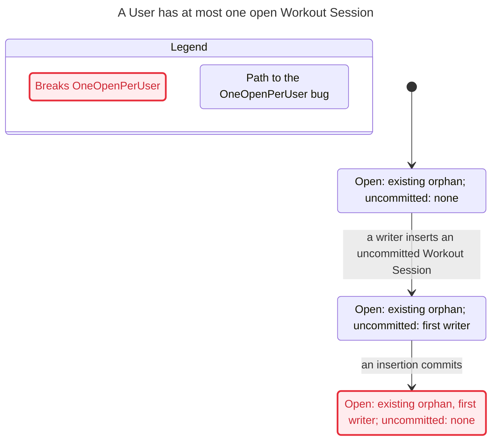

# Validation, 2026-10-31

Source commit: `b03f80f8ead38a2ccc6aef1f33473134dfee4e0c`.
Tools used: TLC 1.7.4 (TLC2 2.19), OpenJDK Temurin 27, PostgreSQL 17.11, Node 26.13.0.

The property is **at most one committed open Workout Session per User**, including sessions with no remaining Workout. No violation was found in the current design within the model's stated bounds. Product code and migrations were unchanged.

| Check | Result |
| --- | --- |
| One User, three insertion transactions, optional existing orphan | PASS: 2,360 distinct states, 9,401 generated states |
| Two Users, three insertion transactions, optional existing orphan | PASS: 2,770 distinct states, 12,045 generated states |
| Actual per-User index declaration installed in temporary Postgres | PASS: second open session rejected, orphan still occupies key, rollback and finish release key, another User may start |
| Scratch real migration with `UNIQUE` removed | FAIL as expected in both TLC configurations and SQL |
| Scratch real migration with key changed to `workout_id` | FAIL as expected in both TLC configurations and SQL |
| Unmodified source rerun after both scratch mutations | PASS |
| `/statechart` interpretation of all six final configurations | Matches TLC; both mutated indexes have the same two-step shortest failure |
| JavaScript syntax checks and isolated Biome check using the repository preset | PASS |

Each model has three insertions and at most one preexisting session. It includes uncommitted key reservations, insertion commit/rollback, committed finish/deletion, and orphaning. Finish/deletion are abstracted to the commit that releases the key. This is not an unbounded proof, a full migration replay, a deployed-database audit, or a proof of authentication, API responses, template copying, or Plan rotation. SQL replay installs the extracted real index on a minimal table rather than running the full application.

## Shortest counterexample for both broken variants

The invariant `OneOpenPerUser` means one User cannot have two open Workout Sessions. In the scratch variants it breaks on this path:

0. The User already has an open Workout Session whose Workout was deleted.
1. A writer inserts another Workout Session, which is still uncommitted.
2. That insertion commits. The same User now has two open Workout Sessions.

The real SQL replay repeats this exact orphan-then-insert path. Both broken index variants allow two committed open rows; the current per-User index rejects the insertion. An additional replay starts with two empty preflight reads and then commits two different Workouts; only the broken variants permit both.

The following is the `/statechart` output for either broken variant's same-User case (the two-User case has the same shortest path):



The chart draws only the shortest bug path because the full state graph exceeds `/statechart`'s 500-state chart budget. The passing configurations also exceed that chart budget and produce reports without charts. Their full finite state spaces were still checked. No state constraints or search depth cutoffs were used.

## Reproduce

```sh
node .agents/skills/verify-workout-session-exclusivity/scripts/verify.mjs
node .agents/skills/verify-workout-session-exclusivity/scripts/mutation-check.mjs
```

Follow `SKILL.md` to read fresh outputs with `/statechart`, review source/model correspondence, and interpret failures. For later drift, use `/maintain-formal-verification-skill`.
